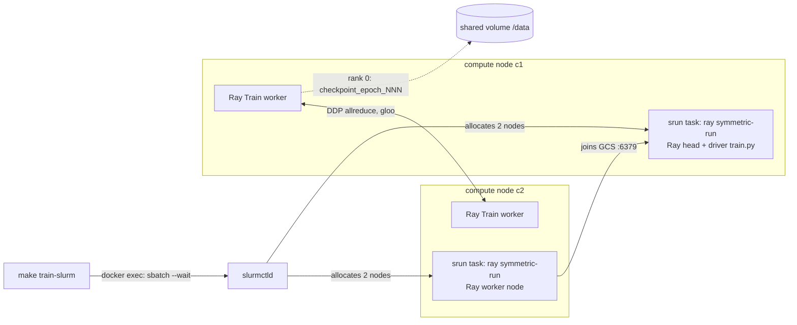

# ray-slurm-vs-kuberay

[](https://github.com/ZionOchayon/ray-slurm-vs-kuberay/actions/workflows/ci.yml)
[](LICENSE)

**One PyTorch training job, two schedulers: Ray on Slurm and Ray on Kubernetes (KubeRay), side by side, with a one-command local cluster, failure drills and measured trade-offs.**

## What works today

| Scheduler                                  | Status                                                                                                  | Proof                                                          |
| ------------------------------------------ | ------------------------------------------------------------------------------------------------------- | -------------------------------------------------------------- |
| Ray on Slurm (`ray symmetric-run`)         | v0.1: a 2-node Ray Train job (2 CPU workers on 2 nodes) with a checkpoint every epoch on shared storage | CI: `make up`, `make train-slurm`, `make verify` on every push |
| Ray on Kubernetes (KubeRay RayJob on kind) | Planned for **v0.2 (30–31 Oct 2026)**, along with failure drills and the measured comparison            | none yet                                                       |

CPU-only lab on one machine: it compares launchers and recovery, not hardware. Every number will come from `bench/`.

## Quickstart

You need Docker with Compose v2 or later, GNU make, bash and git. Docker needs at least 6 GiB of memory.

```bash
make up            # build the image, start Slurm (controller + 2 compute nodes), wait until both nodes are idle
make train-slurm   # submit a 2-node Ray Train job (synthetic data, 2 epochs) and wait for it
make verify        # check the latest run from its artifacts: job state, checkpoints, nodes, logs
make down          # remove the containers and volumes
```

A good run ends with `make verify` printing `PASS` for C1–C5, then `verify <run>: PASS`. Variables: `RUN`, `EPOCHS`, `WORKERS`, `SAMPLES`, `TIMEOUT` (see [docs/SPEC.md §9](docs/SPEC.md)).

**Tested hosts:** Linux (the GitHub Actions runner) and Windows 11 through WSL2 (Ubuntu, Docker Desktop's WSL2 backend, repo cloned inside the WSL filesystem). **macOS: untested.**

## How it works



1. `sbatch` gets 2 nodes. One `srun` task per node runs `ray symmetric-run`, which starts the Ray head on the first node and a Ray worker on the second.
2. `train/train.py` runs only on the head. It is a Ray Train `TorchTrainer` with 2 workers spread over the 2 nodes, DDP over gloo.
3. Each epoch, rank 0 writes a checkpoint to `/data/ray_results/<run>/`. This is a volume shared by every container, because Ray Train needs shared storage for multi-node checkpoints.
4. `make verify` reads `sacct`, `run.json`, the checkpoints and the job log. It does not trust the job state alone, because `symmetric-run` can exit 0 even when `ray start` fails on the head.

## Limits and non-goals

- A lab, not a platform: no GPU, no cloud, no HA, no TLS, no multi-user auth. Jobs run as root in privileged containers. Do not run it on shared machines.
- Both "nodes" share one machine's CPUs, memory and disk. The shared volume behaves like a shared directory, not like NFS or Lustre.
- The synthetic data has random labels; this tests the plumbing, not model quality.

## Roadmap

- **v0.2 (30–31 Oct 2026):** the same `train.py` as a KubeRay RayJob on kind; failure drills (kill a worker, preemption with requeue, two jobs at once); measured results from `bench/`; a "when to use which" guide.
- **v0.3 (after 8 Nov 2026, optional):** Slinky (Slurm on Kubernetes), Prometheus and Grafana, an optional GPU run.

Full plan and requirements: [docs/SPEC.md](docs/SPEC.md).

## Credits and license

The Slurm cluster is derived from [giovtorres/slurm-docker-cluster](https://github.com/giovtorres/slurm-docker-cluster) (MIT); see [NOTICE](NOTICE). Built on [Ray](https://github.com/ray-project/ray) and [PyTorch](https://pytorch.org). Licensed under [Apache-2.0](LICENSE).
