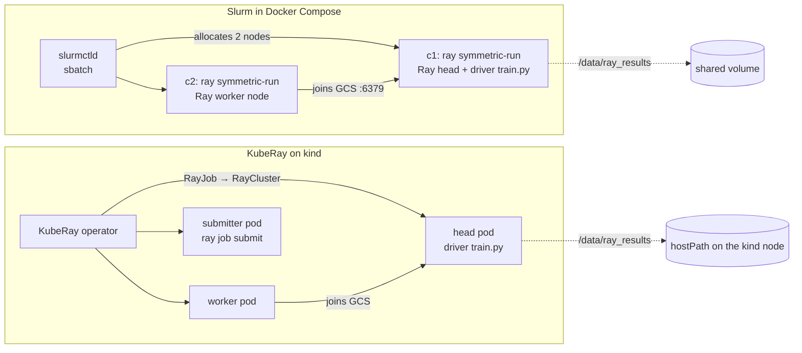

# ray-slurm-vs-kuberay

[](https://github.com/ZionOchayon/ray-slurm-vs-kuberay/actions/workflows/ci.yml)
[](LICENSE)

**One PyTorch training job, two schedulers: Ray on Slurm and Ray on Kubernetes (KubeRay), side by side, with a one-command local cluster, failure drills and measured trade-offs.**

The same `train/train.py` (a Ray Train `TorchTrainer`, 2 CPU workers, a checkpoint every epoch) runs as a 2-node Slurm job and as a KubeRay RayJob on kind. `make verify` checks every run from its artifacts, and both runs record the sha256 of the `train.py` they ran.

## Results

<!-- results:start -->
| Metric | Slurm (ray symmetric-run) | KubeRay (RayJob on kind) |
| --- | --- | --- |
| M1 submit → first step, s: median [min–max] | [23.846 [23.296–25.527], n=5](/docs/results/results.csv#L52) | [34.972 [34.502–39.053], n=5](/docs/results/results.csv#L49) |
| M2 s/epoch, 1 worker (epochs ≥ 1) | [8.173 [7.888–8.956], n=6](/docs/results/results.csv#L73) | [9.366 [7.948–9.511], n=6](/docs/results/results.csv#L67) |
| M2 s/epoch, 2 workers (epochs ≥ 1) | [6.751 [6.655–6.973], n=6](/docs/results/results.csv#L76) | [5.286 [5.018–5.597], n=6](/docs/results/results.csv#L70) |
| M2 ratio 2 workers / 1 worker | [0.826](/docs/results/results.csv#L126) | [0.564](/docs/results/results.csv#L127) |
| M3 kill one worker: time to resume, s | [9.52 [9.373–9.623], n=3](/docs/results/results.csv#L100) | [6.655 [6.385–6.664], n=3](/docs/results/results.csv#L97) |
| M3 kill one worker: steps lost | [65 [15–65], n=3](/docs/results/results.csv#L94) | [55 [55–65], n=3](/docs/results/results.csv#L91) |
| D1 kill one worker: outcome | [pass=3](/docs/results/results.csv#L3) | [pass=3](/docs/results/results.csv#L2) |
| D2 preemption: outcome | admin-requeue: [pass=3](/docs/results/results.csv#L5)<br>usr1-trap: [pass=3](/docs/results/results.csv#L6) | [pass=3](/docs/results/results.csv#L4) |
| D2 preemption: time to resume, s | admin-requeue: [157.389 [157.057–177.587], n=3](/docs/results/results.csv#L28)<br>usr1-trap: [180.019 [174.063–181.586], n=3](/docs/results/results.csv#L31) | [57.162 [56.734–57.438], n=3](/docs/results/results.csv#L25) |
| M4 two jobs at once: outcome | a: [both-failed=2, second-failed=1, flaky](/docs/results/results.csv#L116)<br>b: [serialized=3](/docs/results/results.csv#L117)<br>c: [both-concurrent=3](/docs/results/results.csv#L118) | [both-concurrent=3](/docs/results/results.csv#L115) |
| M4 two jobs at once: makespan, s | a: [107.222 [75.191–1194.933], n=3](/docs/results/results.csv#L106)<br>b: [234.422 [202.377–234.43], n=3](/docs/results/results.csv#L109)<br>c: [43.157 [43.146–43.165], n=3](/docs/results/results.csv#L112) | [63.21 [63.201–63.223], n=3](/docs/results/results.csv#L103) |

_All results come from CPU-only containers on **one** machine, where both "nodes" share the same physical CPUs, memory and disk. They compare how the schedulers launch, recover and share a Ray job. They say nothing about hardware speed, network fabrics or multi-node scaling._

Host: `AMD EPYC 9V74 80-Core Processor; 4 cpu; 15 GiB; Ubuntu 24.04.5 LTS; x86_64`. Raw data: [`docs/results/raw/`](/docs/results/raw/), generated by `make bench`. D2 configs: `usr1-trap`, `admin-requeue` (Slurm), `head-pod-delete` (K8s). M4 configs: (a) default, (b) `--exclusive`, (c) per-job ports, (k) two RayJobs.
<!-- results:end -->

## Quickstart

You need Docker with Compose v2 or later, GNU make, bash and git. Docker needs at least 6 GiB of memory. The KubeRay side also needs [kind](https://kind.sigs.k8s.io/) v0.33.0, kubectl v1.37 and helm v3.22 (on Linux amd64, `sudo bash scripts/install-k8s-tools.sh` installs the pinned versions and checks their sha256).

**Ray on Slurm**

```bash
make up            # build the image, start Slurm (controller + 2 compute nodes), wait until both nodes are idle
make train-slurm   # submit a 2-node Ray Train job (synthetic data, 2 epochs) and wait for it
make verify        # check the latest run from its artifacts: job state, checkpoints, nodes, logs, train.py hash
make down          # remove the containers and volumes (and the kind cluster)
```

**Ray on Kubernetes (KubeRay)**

```bash
make train-k8s           # create the kind cluster, install the KubeRay operator, build and load the image, run the RayJob
make verify SCHED=k8s    # the same checks on the K8s run
```

A good run ends with `make verify` printing `PASS` for C1–C6, then `verify <run>: PASS`. Useful variables: `RUN`, `EPOCHS`, `WORKERS`, `DATA` (`synthetic` or `fashion-mnist`), `SAMPLES`, `LAUNCHER` (`symmetric`, `manual` or `requeue`), `EXCLUSIVE`; see [docs/SPEC.md §9](docs/SPEC.md). Running `make train-slurm EPOCHS=3 RUN=<run>` again on a finished run resumes it from its last checkpoint.

**Tested hosts:** Linux (the GitHub Actions runner) for everything. The v0.1 Slurm side was also tested on Windows 11 through WSL2 (Ubuntu, Docker Desktop's WSL2 backend, repo cloned inside the WSL filesystem); the v0.2 additions have not been run there yet. **macOS: untested.**

## How it works



1. **Slurm:** `sbatch` gets 2 nodes. One `srun` task per node runs `ray symmetric-run`, which starts the Ray head on the first node and a Ray worker on the second, then runs `train.py` on the head only.
2. **KubeRay:** a RayJob describes 1 head pod and 1 worker pod (`num-cpus: 2` each). The operator creates the RayCluster and a submitter pod that runs `ray job submit` against the head.
3. On both, Ray Train places 2 workers with `SPREAD`, one per Ray node, and trains with DDP over gloo.
4. Each epoch, rank 0 writes a checkpoint under `/data/ray_results/<run>/`: a volume shared by every Slurm container, or a hostPath on the single kind node. Ray Train needs shared storage for multi-node checkpoints.
5. `make verify` reads the job state (`sacct` or the RayJob status), `run.json`, the checkpoints, the job log and the `train.py` hash. It does not trust the job state alone: `symmetric-run` can exit 0 when `ray start` fails, and in drill D3 Slurm reported `COMPLETED` for jobs that never trained (M4 (a) in the table above).

## Failure drills

| Drill | Slurm | KubeRay | Pass criterion |
| --- | --- | --- | --- |
| D1 kill one worker (`make drill-kill-worker SCHED=…`) | `pkill -9 -f RayTrainWorker` on the non-head node | the same in the worker pod | the job still succeeds, Ray Train restores the last checkpoint, checkpoints are contiguous |
| D2 preemption (`make drill-preempt SCHED=…`) | `ray-requeue.sbatch`: USR1 → trap → `scontrol requeue`, and a direct `scontrol requeue` | delete the head pod of a RayJob with `backoffLimit: 1` | the run restarts, resumes from its last checkpoint and succeeds |
| D3 two jobs at once (`make drill-two-jobs SCHED=…`) | (a) default, (b) `--exclusive`, (c) per-job Ray ports (`ray-manual.sbatch`) | (k) two RayJobs | every outcome recorded; (b) and (k) both runs verify |

Each drill writes a raw CSV to `docs/results/raw/`; the outcomes and timings are in the results table above. Observations behind them, including the surprises, are in [docs/NOTES.md](docs/NOTES.md).

## When to use which

See [docs/when-to-use-which.md](docs/when-to-use-which.md): a short recommendation and a decision table, where every claim links a result row or a source.

## Repository layout

```
Makefile, versions.env      the single interface; every pinned version and digest
train/train.py              the one workload (+ requirements.lock, hash-locked)
slurm/                      node image, compose cluster, sbatch launchers (symmetric, manual, requeue)
k8s/                        Ray image, kind config, RayJob template
scripts/                    make up / train-slurm / train-k8s / verify
drills/, bench/             failure drills, M1/M2, summarize.py (results table)
docs/                       SPEC.md, NOTES.md, when-to-use-which.md, results/
```

## Reproduce the numbers

`make bench` runs M1 and M2 on both schedulers, then every drill on both, one scheduler at a time, and regenerates `docs/results/results.csv`, `docs/results/table.md` and the block above. The table above came from one run of the [`bench` workflow](.github/workflows/bench.yml) on a GitHub-hosted `ubuntu-24.04` runner (4 vCPU, 16 GB), with both schedulers on the same machine; the host profile and commit are in every raw CSV row. `bash bench/summarize.sh --check README.md` fails if this README's table differs from the raw data (it runs in CI).

## Limits and non-goals

- A lab, not a platform: no GPU, no cloud, no HA, no TLS, no multi-user auth. Jobs run as root in privileged containers. Do not run it on shared machines.
- Both "nodes" share one machine's CPUs, memory and disk. The Slurm volume behaves like a shared directory, not like NFS or Lustre; the K8s side uses a hostPath on one kind node.
- The synthetic data has random labels; this tests the plumbing, not model quality. `DATA=fashion-mnist` trains on real data but is not tuned.

## Roadmap

- **v0.2 (Oct 2026):** done: the KubeRay side, three failure drills on both schedulers, measured results and the guide.
- **v0.3 (after 8 Nov 2026, optional):** Slinky (Slurm on Kubernetes), Prometheus and Grafana, an optional GPU run.

Full plan and requirements: [docs/SPEC.md](docs/SPEC.md).

## Credits and license

The Slurm cluster is derived from [giovtorres/slurm-docker-cluster](https://github.com/giovtorres/slurm-docker-cluster) (MIT); see [NOTICE](NOTICE). Built on [Ray](https://github.com/ray-project/ray), [KubeRay](https://github.com/ray-project/kuberay), [kind](https://github.com/kubernetes-sigs/kind) and [PyTorch](https://pytorch.org). Licensed under [Apache-2.0](LICENSE).
