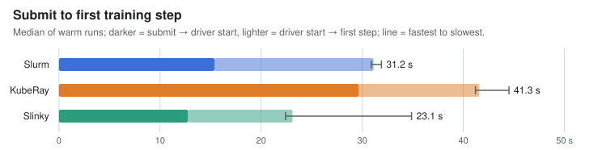
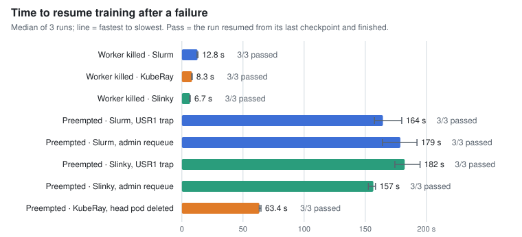
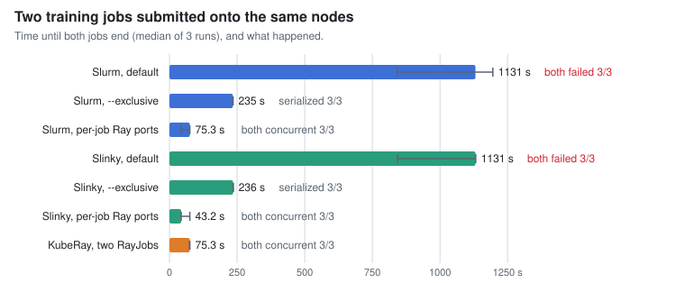
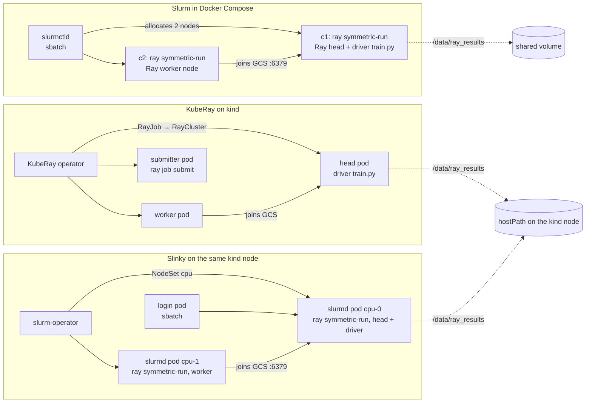

# ray-slurm-vs-kuberay

[](https://github.com/ZionOchayon/ray-slurm-vs-kuberay/actions/workflows/ci.yml)
[](LICENSE)

**One PyTorch training job, three schedulers, side by side: Ray on Slurm, Ray on Kubernetes (KubeRay), and Slurm running inside Kubernetes (Slinky).** One-command local clusters, failure drills, measured results and a Grafana dashboard, all on a laptop or a free CI runner.

The same `train/train.py` (Ray Train, 2 CPU workers, a checkpoint every epoch) runs unchanged on all three. Every run is checked from its artifacts, and every number below is produced by a script.

## Key findings

- **Two `ray symmetric-run` jobs on the same Slurm nodes break each other**, and Slurm still reports `COMPLETED` for jobs that never trained. `--exclusive` or per-job Ray ports fix it.
- **Never trust the job state alone.** `make verify` checks the checkpoints, the job log and the `train.py` hash, and that is what caught the failure above.
- **Worker crashes recover on all three** through Ray Train's checkpoints. **Preemption** works on both Slurm (signal → requeue, same job ID) and KubeRay (pod deletion → resubmit), but a requeued Slurm job waits minutes before it restarts.

The full opinion, with every claim linked to a result row: [docs/when-to-use-which.md](docs/when-to-use-which.md).

## Results

<!-- results:start -->






_All results come from CPU-only containers on **one** machine, where both "nodes" share the same physical CPUs, memory and disk. They compare how the schedulers launch, recover and share a Ray job. They say nothing about hardware speed, network fabrics or multi-node scaling._

Every metric with its min, max and run count: [docs/results/table.md](docs/results/table.md). Host: `AMD EPYC 7763 64-Core Processor; 4 cpu; 15 GiB; Ubuntu 24.04.5 LTS; x86_64`. Raw data: [`docs/results/raw/`](/docs/results/raw/), generated by `make bench`.
<!-- results:end -->

## Quickstart

Needs Docker (Compose v2+, ≥ 6 GiB memory), GNU make, bash and git. The KubeRay and Slinky sides also need kind v0.33, kubectl v1.37 and helm v3.22 (`sudo bash scripts/install-k8s-tools.sh` installs the pinned versions on Linux amd64).

```bash
# Ray on Slurm (Docker Compose: controller + 2 compute nodes)
make up && make train-slurm && make verify

# Ray on Kubernetes (KubeRay RayJob on kind)
make train-k8s && make verify SCHED=k8s

# Slurm on Kubernetes (Slinky, in the same kind cluster)
make up-slinky && make train-slinky && make verify SCHED=slinky

# Prometheus + Grafana (http://127.0.0.1:3000/d/rsk)
make metrics-up

make down   # remove everything
```

`make verify` prints `PASS` for each check, then `verify <run>: PASS`:
C1 job succeeded · C2 `run.json` finished · C3 one checkpoint per epoch · C4 2 workers on 2 nodes · C5 launcher log shows head and worker · C6 same `train.py` bytes on every scheduler.

Common variables: `EPOCHS`, `WORKERS`, `DATA=synthetic|fashion-mnist`, `LAUNCHER=symmetric|manual|requeue`, `EXCLUSIVE=1`, `RUN=<name>` (rerunning a finished `RUN` with more epochs resumes it from its last checkpoint).

Tested on Linux (GitHub Actions, amd64 and arm64 for Slurm). The Slurm side was also run on Windows 11 through WSL2. macOS is untested.

## How it works



- **Slurm:** `sbatch` gets 2 nodes; `ray symmetric-run` starts the Ray head on the first and a worker on the second, then runs `train.py` on the head.
- **KubeRay:** a RayJob creates a head pod, a worker pod and a submitter pod that runs `ray job submit`.
- **Slinky:** SchedMD's slurm-operator runs Slurm as pods; the same sbatch file runs unchanged.

On all three, Ray Train spreads 2 workers over the 2 nodes (DDP over gloo), and rank 0 writes a checkpoint to shared storage every epoch.

## Failure drills

Run with `make drill-kill-worker|drill-preempt|drill-two-jobs SCHED=slurm|k8s|slinky`; results are in the charts above, raw CSVs in [docs/results/raw/](docs/results/raw/), and the surprises behind them in [docs/NOTES.md](docs/NOTES.md).

- **D1 kill a worker:** `pkill -9` one Ray Train worker; the job must restore its last checkpoint and succeed.
- **D2 preemption:** Slurm USR1 trap → `scontrol requeue` (and a direct requeue); KubeRay deletes the head pod. The run must resume and succeed.
- **D3 two jobs at once:** default, `--exclusive` and per-job Ray ports on Slurm; two RayJobs on KubeRay.

`make bench` reruns everything and regenerates the charts and [the full table](docs/results/table.md); CI fails if either differs from the raw data.

## Repository layout

```
Makefile, versions.env   the single interface; every pinned version and digest
train/                   the one workload (train.py + hash-locked requirements)
slurm/, slinky/          Slurm node images, Compose cluster, sbatch launchers
k8s/                     Ray image, kind config, RayJob, Slinky values, monitoring manifests
observability/           Prometheus configs and the Grafana dashboard
scripts/, drills/, bench/  make targets, failure drills, benchmarks
docs/                    when-to-use-which.md, NOTES.md, results/
```

## Limits

A CPU-only lab on one machine: both "nodes" share the same CPUs, memory and disk, so it compares how schedulers launch, recover and share a Ray job, not hardware speed or scaling. No GPU, cloud, HA, TLS or multi-user auth; jobs run as root in privileged containers, so do not run it on shared machines. Synthetic data has random labels: it tests the plumbing, not the model.

## Status

- **v0.1** Ray on Slurm, verified in CI
- **v0.2** KubeRay, three failure drills, measured results and the guide
- **v0.3** Slinky as a third scheduler; Prometheus and Grafana for all three
- **Next (optional):** one documented GPU run, outside CI and the results

## Credits and license

The Slurm cluster is derived from [giovtorres/slurm-docker-cluster](https://github.com/giovtorres/slurm-docker-cluster) (MIT); see [NOTICE](NOTICE). Built on [Ray](https://github.com/ray-project/ray), [KubeRay](https://github.com/ray-project/kuberay), [Slinky](https://github.com/SlinkyProject/slurm-operator), [kind](https://github.com/kubernetes-sigs/kind), [Prometheus](https://prometheus.io), [Grafana](https://grafana.com) and [PyTorch](https://pytorch.org). Licensed under [Apache-2.0](LICENSE).
