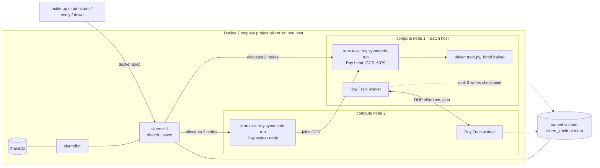
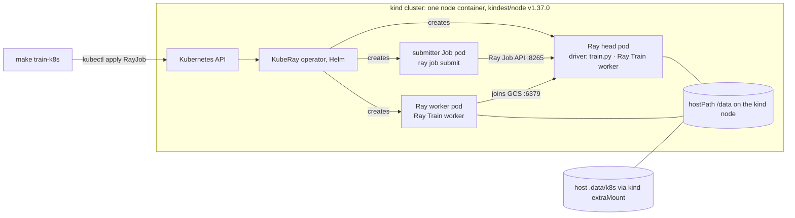

# ray-slurm-vs-kuberay: Specification

Status: v0.1 build spec · Written 2026-10-24 · License: Apache-2.0

Conventions

- MUST, SHOULD and MAY are used as in RFC 2119.
- **UNVERIFIED** means the claim was not checked against a primary source on 2026-10-24.
- **HYPOTHESIS** means the behavior is inferred from source code or docs but not yet observed in this lab. Each one names the check that settles it.
- No number in this document is a measurement. Numbers are versions, ports, budgets (targets to be checked) or limits published by a vendor.
- Paths inside containers are absolute (`/data/...`). Repo paths are relative to the repo root.

---

## 1. Summary

> **One PyTorch training job, two schedulers: Ray on Slurm and Ray on Kubernetes (KubeRay), side by side, with a one-command local cluster, failure drills and measured trade-offs.**

One `train/train.py` file (a Ray Train TorchTrainer with 2 CPU workers and a checkpoint every epoch) runs on a 2-node Slurm cluster in Docker Compose. From v0.2 the same file also runs as a KubeRay RayJob on kind. Each run starts from one Makefile target, `make verify` checks it, and failure drills stress it (killing a worker, preemption, two jobs at once). Every timing or outcome reported comes from a script in `bench/`. It is a CPU-only lab that runs on a laptop and on free CI. It compares how the two schedulers launch, recover and share a Ray job, not how fast any hardware is, and it ends with a written opinion on when to use which.

## 2. Goals and non-goals

### Goals

- **G1:** One workload, byte-identical on both schedulers (`train/train.py`, proven by a hash).
- **G2:** One command brings up each local cluster. Clean clone to first checkpoint uses only Makefile targets.
- **G3:** Four defined metrics, measured on both schedulers by scripts, with raw data committed.
- **G4:** Three failure drills (worker kill, preemption, two concurrent jobs), each with an expected behavior and a pass criterion.
- **G5:** A short, opinionated "when to use which" guide. Every claim in it cites a result row or a source link.
- **G6:** An honest learning record of Slurm. Observed behavior goes in `docs/NOTES.md`, and surprises are kept, not hidden.

### Non-goals (explicit)

- **GPU** in v0.1 and v0.2. v0.3 may add one optional GPU run, outside CI.
- **Cloud:** no cloud accounts, managed Kubernetes, object storage or paid services.
- **Production hardening:**
  - no highly available `slurmctld` or Ray head;
  - no TLS;
  - no fair-share or QoS policy design;
  - no autoscaling;
  - no backups.
    Containers run `privileged` as upstream requires, so this lab is not for shared machines.
- **Multi-user auth:** no LDAP or SSO and no per-user accounts. Jobs run as root inside the lab containers, and munge only authenticates daemons to each other.
- **Performance or scaling claims:** nothing like "production-grade", "scales to N nodes or GPUs", or "X is faster than Y" beyond what the measured table shows on the stated host.
- **Model quality:** synthetic labels are random, and FashionMNIST accuracy is reported but not tuned.
- **Windows-native shells:** Git Bash and PowerShell are unsupported. Windows is supported only through WSL2.
- **Slinky, Prometheus or Grafana** before v0.3.

## 3. Success criteria

Thresholds below are **budgets** set before any measurement. The v0.1 gate checks them (in T6), and the actual values go into `docs/NOTES.md`, not the README.

| ID    | Criterion                                                  | Budget / pass rule                                                                                                                                                                                                                                                                   | How checked                                                                | Milestone |
| ----- | ---------------------------------------------------------- | ------------------------------------------------------------------------------------------------------------------------------------------------------------------------------------------------------------------------------------------------------------------------------------ | -------------------------------------------------------------------------- | --------- |
| SC-01 | Clean clone to first checkpoint on reference host R2 (§16) | ≤ 15 min cold (images not cached), ≤ 5 min warm                                                                                                                                                                                                                                      | `time (make up && make train-slurm EPOCHS=1)` in a fresh clone             | v0.1      |
| SC-02 | CI is green on `main` and finishes inside the budget       | Job ≤ 20 min on `ubuntu-24.04`; hard `timeout-minutes: 30`                                                                                                                                                                                                                           | GitHub Actions run duration                                                | v0.1      |
| SC-03 | The 30-second README test                                  | Someone who has never seen the repo looks at the first screen for 30 s and correctly answers four questions: (1) what is compared, (2) how to run it (one command per step), (3) what works today (badge + status table), (4) that it is a CPU-only lab, not a benchmark of hardware | Cold read by one person, or a self-check against §12                       | v0.1      |
| SC-04 | Every number in the README is reproduced by a script       | `bench/summarize.py --check README.md` exits 0 (the table is generated, never typed)                                                                                                                                                                                                 | CI step                                                                    | v0.2      |
| SC-05 | Zero cost                                                  | Only standard GitHub-hosted runners; no `secrets.*` other than the default `GITHUB_TOKEN`; no cloud endpoints                                                                                                                                                                        | `! grep -rn 'secrets\.' .github/`                                          | v0.1      |
| SC-06 | Comparison complete                                        | All 4 metrics on both schedulers and all 3 drills on both schedulers are reported, or marked "N/A" with a reason                                                                                                                                                                     | `docs/results/results.csv` row count check in `bench/summarize.py --check` | v0.2      |

## 4. Constraints

- **CPU only:** runs on a laptop and on a free GitHub-hosted runner for public repos (4 vCPU, 16 GB RAM, 14 GB SSD, per GitHub docs, checked 2026-10-24). No GPU in v0.1 or v0.2.
- **Zero cost:** no cloud accounts and no paid services.
- **Data:** public data only (FashionMNIST, v0.2) plus `--data synthetic`. CI uses synthetic data only and never downloads datasets. Dependency and image downloads at build time are allowed.
- **Provenance:** nothing from any former employer or client. That covers names, code, configs, data and internal details. No defense-related content. Production experience is described only at capability level.
- **Privacy:** no secrets, personal email, phone or ID. Commits use the GitHub noreply address.
- **No overclaiming:** this is a lab. Every number in the README comes from a script in `bench/`.
- **No invented facts:** anything unverified is marked UNVERIFIED or HYPOTHESIS, with a check.
- **License and language:** Apache-2.0, English.
- **Time:** v0.1 fits about 3 hours for one engineer (see `docs/TASKS.md`).
- **Supported hosts:** tested on Linux (the CI runner) and Windows 11 through WSL2 (Ubuntu, Docker Desktop WSL2 backend, repo cloned inside the WSL filesystem under `~/code/`, not `/mnt/c`). macOS is expected to work but **untested**. Each needs Docker Engine with Compose v2 or later, GNU make, bash and git. v0.2 adds kind, kubectl and helm. No Python is needed on the host; all Python runs in containers.

## 5. Milestones with exit gates

### v0.1: Slurm side. Sat 24 Oct 2026, hard stop 17:00 Israel time

- **Scope:** FR-01 to FR-11 (MUST) and NFR-01 to NFR-10. FR-12, FR-13 and FR-14 moved to v0.2 in the 14:35 re-plan.
- **Exit gate.** v0.1 is published only if every item passes:
  1. A fresh clone in an empty directory passes `make up && make train-slurm && make verify && make down` on the build host.
  2. CI is green on `main`.
  3. The privacy checks pass (NFR-06), including the local denylist grep.
  4. The banned-phrase check passes (NFR-09).
  5. Tag `v0.1.0` exists, and the repo is switched from private to public only after items 1 to 4 pass. CI then reruns green on the public runner.
- **If the gate fails at 17:00:** the repo stays private, and the remaining work moves to the v0.2 window. No partial publication.

### v0.2: the comparison. Fri 30 and Sat 31 Oct 2026, afternoons

- **Scope:** FR-20 to FR-29 (MUST) and FR-30 to FR-32 (SHOULD).
- **Exit gate.** All of the following:
  1. Every v0.2 MUST passes its Verify command.
  2. CI is green with the Slurm job and the kind job.
  3. The README results table is generated by `make bench` and SC-04 passes.
  4. `docs/when-to-use-which.md` exists, and every claim in it links a result row or a source.
  5. Tag `v0.2.0` exists.

### v0.3: optional, after 8 Nov 2026

Each item gets its own spec section when started; Slinky and Prometheus + Grafana were started on 2026-10-28 and are specified in §18. The scope is one paragraph per item:

- **Slinky (Slurm on Kubernetes):** install SchedMD's slurm-operator into the kind cluster and run the same `ray-symmetric.sbatch` against Slurm pods. This adds a third column to the table, "Slurm on K8s". The open question is whether `ray symmetric-run` behaves the same when the Slurm nodes are pods.
- **Prometheus and Grafana:** scrape Ray's metrics endpoint and the Slurm job state on both stacks. Ship one dashboard JSON that shows worker restarts and epoch time during the drills. This is for observability, not for new metrics: the numbers in the table still come from `bench/`.
- **Optional GPU run:** one documented manual run of `train.py --use-gpu` on a single GPU host. Upstream publishes `-gpu` image variants, but its CI does not test GPUs. It is outside CI and outside the results table, reported separately with its hardware stated, and makes no scaling claim.

## 6. Functional requirements

Each requirement's Verify command runs from the repo root on the host, after `make up` unless noted.

### v0.1 (full detail)

**FR-01 [MUST, v0.1]** `make up` starts a Slurm cluster and returns only when it can run jobs. The cluster has 1 controller (`slurmctld`), `slurmdbd`, MariaDB and 2 compute nodes, all built from the pinned images in `versions.env`.

- Given Docker Engine is reachable and has ≥ `MIN_MEM_GIB` (default 6) GiB of memory
- When `make up` runs
- Then it exits 0 within 600 s, and `sinfo` reports 2 idle nodes in partition `cpu`
- Verify: `make up && docker exec slurmctld sinfo -h -p cpu -t idle -o %D | grep -qx 2`

**FR-02 [MUST, v0.1]** The controller and both compute nodes mount the same volume at `/data`. `/data/ray_results` is the Ray Train `storage_path` root.

- Given the cluster is up
- When a file is written to `/data` on compute node 1
- Then compute node 2 reads the same bytes
- Verify: `docker exec slurm-cpu-worker-1 sh -c 'echo ok > /data/.probe' && docker exec slurm-cpu-worker-2 grep -qx ok /data/.probe`

**FR-03 [MUST, v0.1]** The Slurm job writes a Ray Train checkpoint to shared storage at the end of every epoch.

- Given the cluster is up and the synthetic-data flag is set
- When `make train-slurm EPOCHS=2 RUN=<run>` runs
- Then the job ends COMPLETED and `/data/ray_results/<run>/` holds 2 checkpoints (`checkpoint_epoch_000`, `checkpoint_epoch_001`), each containing `model.pt`
- Verify: `make verify RUN=<run>` exits 0

**FR-04 [MUST, v0.1]** `train/train.py` runs a Ray Train `TorchTrainer` with `--workers` workers (default 2). Each worker uses 1 CPU and no GPU, under `placement_strategy="SPREAD"`. In the 2-node job, the 2 workers run on 2 different Ray nodes.

- Given the cluster is up
- When `make train-slurm WORKERS=2 RUN=<run>` runs
- Then `run.json` lists 2 distinct values in `worker_node_ips`
- Verify: `make verify RUN=<run>` (check C4) exits 0

**FR-05 [MUST, v0.1]** `--data synthetic` builds a seeded in-memory dataset (`--synthetic-samples` × 1×28×28 float32 inputs, 10 classes) without network access or files on disk.

- Given the cluster is up
- When `make train-slurm DATA=synthetic RUN=<run>` runs
- Then the run passes verification and no dataset directory is created
- Verify: `make verify RUN=<run> && ! docker exec slurmctld test -e /data/datasets`

**FR-06 [MUST, v0.1]** `slurm/sbatch/ray-symmetric.sbatch` launches Ray with `ray symmetric-run`. It uses one `srun` task per node on 2 nodes and sets:

- `--address <batch-host-IP>:6379`, `--min-nodes 2`, `--num-cpus=$SLURM_CPUS_PER_TASK`, `--num-gpus=0`
- the environment variable `RAY_SYMMETRIC_RUN_CLUSTER_WAIT_TIMEOUT=120`

The entrypoint `train.py` runs only on the head node.

- Given a submitted job
- When it finishes
- Then its log contains exactly one `On head node.` line and one `On worker node.` line (strings from `symmetric_run.py`, Ray 2.59.0)
- Verify: `make verify RUN=<run>` (check C5) exits 0

**FR-07 [MUST, v0.1]** `make train-slurm` submits the job, blocks until it ends, records the job ID and exits with a code that reflects the final Slurm state. It prints RUN, job ID, final state, elapsed time, the log path and the last 40 log lines.

- Given the cluster is up
- When `make train-slurm EPOCHS=1 RUN=<run>` runs
- Then the target exits 0 only when the final state is COMPLETED, and `.runs/<run>.jobid` and `.runs/latest` exist
- Verify: `make train-slurm EPOCHS=1 RUN=fr07 && test -s .runs/fr07.jobid && grep -qx fr07 .runs/latest`

**FR-08 [MUST, v0.1]** `make verify RUN=<run>` exits 0 only if all checks pass. It prints one `PASS` or `FAIL` line per check:

- **C1:** `sacct` State = COMPLETED and ExitCode = `0:0` (retried for up to 30 s)
- **C2:** `run.json` exists, with `status == "finished"`
- **C3:** the number of `checkpoint_epoch_*` directories equals `run.json.epochs`, and each one contains `model.pt`
- **C4:** when `workers == 2`, `worker_node_ips` has 2 distinct values
- **C5:** the job log has exactly one head-node line and one worker-node line
- **C6 (v0.2, with FR-14):** `run.json.train_py_sha256` equals the sha256 of `/opt/rayslurm/train/train.py`

Acceptance:

- Given a verified run whose checkpoint `checkpoint_epoch_001` is deleted
- When `make verify RUN=<run>` runs
- Then it exits 1, and the C3 line says FAIL
- Verify: `docker exec slurmctld rm -rf /data/ray_results/<run>/checkpoint_epoch_001 && ! make verify RUN=<run>`

**FR-09 [MUST, v0.1]** `make down` removes all lab containers, networks and volumes, and is idempotent.

- Given the cluster is up, or already down
- When `make down` runs twice
- Then both runs exit 0 and no container with compose project `slurm` remains
- Verify: `make down && make down && test -z "$(docker ps -aq --filter label=com.docker.compose.project=slurm)"`

**FR-10 [MUST, v0.1]** `.github/workflows/ci.yml` runs on push to `main`, on pull requests and on manual dispatch, using `ubuntu-24.04`. Its steps in order:

1. hygiene checks, then a negative preflight (FR-11)
2. `make up`
3. shared `/data` probe
4. `make train-slurm EPOCHS=2 RUN=ci-<run_id>` (synthetic data)
5. `make verify`
6. negative verify (FR-08)
7. negative train (NFR-10)
8. logs uploaded as an artifact on failure
9. `make down` always

- Given a push to `main`
- When the workflow runs
- Then it concludes `success` within `timeout-minutes: 30`
- Verify: `gh run list --workflow ci.yml --branch main --limit 1 --json conclusion -q '.[0].conclusion' | grep -qx success`

**FR-11 [MUST, v0.1]** `make up` runs a preflight first. If Docker Engine is unreachable, or engine memory is below `MIN_MEM_GIB` GiB, it exits 1 before building anything, with a one-line reason.

- Given a reachable engine
- When `make up MIN_MEM_GIB=1024` runs
- Then it fails (scripts/up.sh exits 1; make itself returns 2) and prints `preflight: engine memory` followed by the measured and required values
- Verify: `! make up MIN_MEM_GIB=1024 > /tmp/pf.log 2>&1 && grep -q "preflight: engine memory" /tmp/pf.log` (GNU make maps the script's exit 1 to exit 2, so check non-zero plus the message)

**FR-12 [MUST, v0.2]** (dropped from v0.1 in the re-plan; required by FR-26) `train.py` resumes from `ray.train.get_checkpoint()` when one exists. It starts at the restored epoch + 1 and logs `restored epoch=<n>`. Ray Train finds the earlier run by the same `RunConfig(storage_path, name)` pair (Ray 2.59.0 fault-tolerance docs).

- Given a completed run `<run>` with EPOCHS=2
- When `make train-slurm EPOCHS=3 RUN=<run>` runs
- Then only epoch 2 trains and `checkpoint_epoch_002` is added
- HYPOTHESIS: Ray Train V2 restores from a run that already finished, not only from an interrupted one. Check with this command.
- Verify: `make train-slurm EPOCHS=3 RUN=<run> && make verify RUN=<run> && docker exec slurmctld grep -q 'restored epoch=1' /data/logs/<run>-$(cat .runs/<run>.jobid).out`

**FR-13 [MUST, v0.2]** (dropped from v0.1 in the re-plan; required by FR-28) `train.py` appends JSON Lines events to `/data/ray_results/<run>/events.jsonl`. The schema is in §9.5. These events are the only end events used by the metrics in §10.

- Given any run
- When it completes
- Then `events.jsonl` contains `driver_start`, `first_step`, one `epoch_end` per epoch, and `run_end`
- Verify: `docker exec slurmctld grep -c '"event": "epoch_end"' /data/ray_results/<run>/events.jsonl`, which equals EPOCHS

**FR-14 [MUST, v0.2]** (moved from v0.1 per the cut order; required by FR-21) `train.py` records the sha256 of its own file in `run.json.train_py_sha256`.

- Verify: `make verify RUN=<run>` (check C6)

### v0.2 (requirements with acceptance criteria)

**FR-20 [MUST, v0.2]** `--data fashion-mnist` downloads FashionMNIST once, through torchvision, into `/data/datasets` from the driver before `trainer.fit()`. Workers then load it with `download=False`.

- Given network access
- When `make train-slurm DATA=fashion-mnist EPOCHS=1 RUN=<run>` runs
- Then the run passes verification and `run.json.val_accuracy > 0.10` (above chance for 10 classes; not a quality target)
- Verify: `make verify RUN=<run> && docker exec slurmctld /opt/venv/bin/python -c "import json;assert json.load(open('/data/ray_results/<run>/run.json'))['val_accuracy']>0.10"`

**FR-21 [MUST, v0.2]** Both schedulers run the same `train/train.py` bytes.

- Given a Slurm run and a K8s run
- When both are verified
- Then both `run.json.train_py_sha256` values equal `sha256sum train/train.py` at the same commit
- Verify: `make verify RUN=<slurm-run> && make verify SCHED=k8s RUN=<k8s-run>` (C6 is mandatory from v0.2)

**FR-22 [MUST, v0.2]** `make train-k8s` does the following, then waits for the job to reach a terminal state:

1. creates a single-node kind cluster from the pinned node image, with an extraMount from host `.data/k8s` to node `/data`
2. installs the KubeRay operator with Helm (pinned chart version)
3. builds `rayk8s:<RAY_VERSION>` (FROM the pinned `rayproject/ray` digest, adding torch CPU and `train/`) and loads it into kind
4. applies `k8s/rayjob.yaml`, which runs the same `train.py` command line with 1 head pod and 1 worker pod
   - each pod gets `num-cpus: "2"`, CPU requests and limits of 2, and a hostPath `/data`
   - `storage_path` is `/data/ray_results`

- Given kind, kubectl and helm at the pinned versions
- When `make train-k8s EPOCHS=2 RUN=<run>` runs
- Then the RayJob ends with `jobStatus: SUCCEEDED`, and the target exits 0
- Verify: `make train-k8s EPOCHS=2 RUN=<run> && make verify SCHED=k8s RUN=<run>`

**FR-23 [MUST, v0.2]** `slurm/sbatch/ray-manual.sbatch` starts the Ray head with `srun -w <head>` and the workers with `srun --exclude <head>`, using a per-job port block (§8.5) and a per-job `--temp-dir`. It exports `RAY_ADDRESS` to the driver, so the driver never auto-detects another job's cluster. The job log prints the full port map.

- Given the cluster is up
- When the job runs alone
- Then it passes `make verify` (C5 is replaced by a check for the port-map line)
- Verify: `make train-slurm LAUNCHER=manual RUN=<run> && make verify RUN=<run>`

**FR-24 [MUST, v0.2]** `slurm/sbatch/ray-requeue.sbatch` requeues itself when signalled and resumes on restart:

- It adds `#SBATCH --requeue` and `#SBATCH --signal=B:USR1@60`, plus a bash `trap` on USR1 that runs `scontrol requeue $SLURM_JOB_ID`.
- `RUN` is fixed at submission, so it is the same on every restart and Ray Train resumes from the latest checkpoint (FR-12).
- `train.py` records `SLURM_RESTART_COUNT` in the events.

Acceptance:

- Given a running job past its first checkpoint
- When `drill-preempt` signals it
- Then the job restarts with the same job ID, and ends COMPLETED with EPOCHS contiguous checkpoints
- Verify: `make drill-preempt SCHED=slurm` exits 0

**FR-25 [MUST, v0.2]** `make drill-kill-worker SCHED=slurm|k8s` runs the scenario in §11 D1 and writes `docs/results/raw/drill-kill-worker-<sched>-<ts>.csv`.

- Given a run past `checkpoint_epoch_000` with `--max-failures 3`
- When one Ray Train worker process on the non-head node is killed
- Then the run ends COMPLETED/SUCCEEDED with contiguous checkpoints and a `restored` event, and the CSV holds `time_to_resume_s` and `steps_lost` for each rep
- Verify: `make drill-kill-worker SCHED=slurm && make drill-kill-worker SCHED=k8s`

**FR-26 [MUST, v0.2]** `make drill-preempt SCHED=slurm|k8s` runs §11 D2 and writes a raw CSV.

- Given a run past its first checkpoint (Slurm: `ray-requeue.sbatch`)
- When the drill preempts it (Slurm: USR1, then requeue; K8s: head pod deleted)
- Then the run restarts, resumes from the latest checkpoint and ends COMPLETED/SUCCEEDED with restart count ≥ 1 and contiguous checkpoints
- Verify: `make drill-preempt SCHED=slurm && make drill-preempt SCHED=k8s`

**FR-27 [MUST, v0.2]** `make drill-two-jobs SCHED=slurm|k8s` runs §11 D3 for every configuration and writes a raw CSV of outcomes.

- Given an idle cluster
- When two jobs are submitted back to back in each configuration (a), (b), (c) and (k)
- Then the CSV records each job's terminal state and message for every rep, and in (b), (c) and (k) both runs pass `make verify`, unless a documented finding explains a failure (§11 D3)
- Verify: `make drill-two-jobs SCHED=slurm && make drill-two-jobs SCHED=k8s`

**FR-28 [MUST, v0.2]** `make bench` runs M1 and M2 (§10) on both schedulers and runs the drill scripts. It then runs `bench/summarize.py`, which writes:

- `docs/results/results.csv`
- `docs/results/table.md`
- the README results block between `<!-- results:start -->` and `<!-- results:end -->`

`bench/summarize.py --check README.md` exits 1 if the README block differs from the generated one.

- Given both clusters can run (`make up`, `make train-k8s` prerequisites)
- When `make bench` runs to completion
- Then `docs/results/results.csv` holds every M1–M4 row for both schedulers (or an `N/A` row with a reason), and the README block equals `docs/results/table.md`
- Verify: `make bench && bench/summarize.py --check README.md` (run inside the project image; see §9)

**FR-29 [MUST, v0.2]** `docs/when-to-use-which.md` gives:

- a recommendation in 5 to 10 bullets
- a decision table with these factors: existing cluster type, multi-tenancy, preemption model, elasticity, operational surface, and the fit for the team's skills
- for every claim, a link to a row in `docs/results/results.csv` or an external source

Acceptance:

- Given `docs/results/results.csv` from FR-28
- When the guide is reviewed
- Then every recommendation bullet carries at least one link, and no claim relies on a number that is not in `results.csv`
- Verify: `grep -c 'results.csv#\|https://' docs/when-to-use-which.md` ≥ the number of bullets, plus NFR-09's banned-phrase grep

**FR-30 [SHOULD, v0.2]** CI adds a `kind` job (`make train-k8s` + `make verify SCHED=k8s`) and an `ubuntu-24.04-arm` matrix entry for the Slurm job.

**FR-31 [SHOULD, v0.2]** Both images install Python dependencies from a hash-locked requirements file (`--require-hashes`).

**FR-32 [SHOULD, v0.2]** CI runs weekly on a `schedule` to catch rot, such as an upstream image or wheel being removed.

## 7. Non-functional requirements

**NFR-01 [MUST, v0.1] Reproducibility and pinned versions.**

- Every version and image lives in one file, `versions.env`. Images are pinned by tag **and** `@sha256` digest, and Python packages by `==`.
- Dockerfile `ARG`s have no defaults, so a missing pin fails the build.
- Nothing uses a `latest` tag.
- Verify: `! grep -nE ':latest\b|@latest\b' versions.env slurm/Dockerfile slurm/docker-compose.yml .github/workflows/*.yml && test "$(grep -c '@sha256:' versions.env)" -ge 2`

**NFR-02 [MUST, v0.1] CI duration.**

- The CI Slurm job's budget is ≤ 20 min, and `timeout-minutes: 30` is a hard limit.
- Verify: `gh run view <id> --json startedAt,updatedAt`; the difference is ≤ 20 min.

**NFR-03 [MUST, v0.1] Laptop runtime.**

- Same budget as SC-01 on reference host R2.
- Verify: `time (make up && make train-slurm EPOCHS=1)` in a fresh clone. Record the result in `docs/NOTES.md`.

**NFR-04 [MUST, v0.1] Resource footprint.**

- The cluster plus a 2-epoch synthetic run (default `SAMPLES`) completes on the **private-repo** runner (design target: 2 vCPU, 7 GB RAM, 14 GB SSD; the stricter of the two runners) and on R2 with Docker engine memory ≥ `MIN_MEM_GIB`. Passing there implies passing on the public runner (4 vCPU, 16 GB).
- In v0.2 `make bench` samples `docker stats --no-stream` every 5 s and reports peak memory per container. The default `MIN_MEM_GIB=6` is an ASSUMPTION; T4 calibrates it.
- Verify: CI green (FR-10), plus `make up` passing preflight on R2.

**NFR-05 [MUST amd64 in v0.1; SHOULD arm64 in v0.2] Architectures.**

- The base images are multi-arch (amd64 and arm64, per Docker Hub, 2026-10-24), and the torch, torchvision and Ray wheels exist for x86_64 and aarch64 (PyPI and the PyTorch CPU index, 2026-10-24). arm64 is proven only by FR-30.
- Verify (v0.1): CI green on `ubuntu-24.04`.

**NFR-06 [MUST, v0.1] Privacy and provenance.**

- All commit author and committer emails end with `@users.noreply.github.com`.
- No personal data in files.
- No employer, client, project or defense content. The check uses a **local, untracked** denylist at `~/.config/rayslurm/denylist.txt`, which is never committed because its contents are the names to keep out.
- Verify: `test -z "$(git log --format='%ae%n%ce' | sort -u | grep -v '@users.noreply.github.com$')" && { git grep -niI -f ~/.config/rayslurm/denylist.txt; test $? -eq 1; }`

**NFR-07 [MUST, v0.1] Line endings.**

- `.gitattributes` forces LF for `*.sh`, `*.sbatch`, `*.py`, `*.yml`, `*.yaml`, `*.env`, `Makefile` and `Dockerfile`. A Windows checkout must not break bash.
- Verify: `! git ls-files --eol | grep -q 'i/crlf'`

**NFR-08 [MUST, v0.1] Licensing and attribution.**

- `LICENSE` is Apache-2.0.
- `NOTICE` credits giovtorres/slurm-docker-cluster (MIT) for the derived `slurm/docker-compose.yml`, and the upstream MIT license text is kept at `slurm/LICENSE.slurm-docker-cluster`.
- Verify: `grep -q 'Apache License' LICENSE && grep -q 'slurm-docker-cluster' NOTICE && grep -q 'MIT' slurm/LICENSE.slurm-docker-cluster`

**NFR-09 [MUST, v0.1] Honest language.**

- The README and the guide never say "production-grade", "production-ready", "enterprise-grade" or "scales to".
- The README states the CPU-only, single-host nature directly under the results table.
- Verify: `! grep -niE 'production[- ](grade|ready)|enterprise[- ]grade|scales to' README.md docs/when-to-use-which.md 2>/dev/null`

**NFR-10 [MUST, v0.1] Loud failure.**

- Every script uses `set -euo pipefail`.
- `make train-slurm` exits non-zero for any final state other than COMPLETED.
- `make verify` checks artifacts, not just the job state. This matters because `ray symmetric-run` 2.59.0 exits 0 when `ray start` fails on the head node (it catches `CalledProcessError` and does not call `sys.exit`; verified in source).
- Verify: `! make train-slurm RUN=neg DATA=bogus` (argparse rejects the value, the job ends FAILED, and the target exits 1)

**NFR-11 [SHOULD, v0.1] Minimal host prerequisites.**

- The host needs docker, compose, make, bash and git. v0.2 adds kind, kubectl and helm. No Python or pip on the host.
- Verify: `! grep -nE '(^|[ ;&|])(python3?|pip3?) ' Makefile scripts/*.sh`

## 8. Architecture

### 8.1 Components

| Component                                 | v         | What it is                                                                                                                                                                                                                                       |
| ----------------------------------------- | --------- | ------------------------------------------------------------------------------------------------------------------------------------------------------------------------------------------------------------------------------------------------ |
| `versions.env`                            | 0.1       | Every pinned version and digest; the Makefile includes it and compose reads it with `--env-file`                                                                                                                                                 |
| `slurm/Dockerfile`                        | 0.1       | `FROM ${SLURM_BASE_IMAGE}` (Rocky Linux 9 with Python 3.12 and Slurm 26.05.5) plus a venv at `/opt/venv` holding torch CPU, torchvision CPU and `ray[train]`. It does not change the global `PATH`, so upstream entrypoint scripts are untouched |
| `slurm/docker-compose.yml`                | 0.1       | Derived from upstream 3.0.2. Keeps `mysql`, `slurmdbd`, `slurmctld` and `cpu-worker` (2 replicas, which self-register as `c1` and `c2` through `slurmd -Z`). The repo is mounted read-only at `/opt/rayslurm`                                    |
| `slurm/sbatch/*.sbatch`                   | 0.1 / 0.2 | `ray-symmetric` (v0.1), `ray-manual` and `ray-requeue` (v0.2)                                                                                                                                                                                    |
| `train/train.py`                          | 0.1       | The single workload for both schedulers                                                                                                                                                                                                          |
| `scripts/up.sh`, `scripts/train-slurm.sh` | 0.1       | Host-side bash called by the Makefile                                                                                                                                                                                                            |
| `scripts/verify.py`                       | 0.1       | Runs **inside** `slurmctld` (or inside the project image with `--no-slurm` for K8s)                                                                                                                                                              |
| `k8s/`                                    | 0.2       | `Dockerfile`, `kind-config.yaml`, `rayjob.yaml`                                                                                                                                                                                                  |
| `bench/`, `drills/`                       | 0.2       | Metric and drill scripts; `summarize.py` runs inside the project image                                                                                                                                                                           |

### 8.2 Ray on Slurm (v0.1)



### 8.3 Ray on Kubernetes with KubeRay (v0.2)



The submitter pod follows KubeRay's default submission mode as documented. That this still holds in v1.7.1 is UNVERIFIED; check with `kubectl get jobs` during FR-22.

### 8.4 Data flow and storage (Slurm, v0.1)

1. `make train-slurm` runs `docker exec slurmctld sbatch --parsable --wait ...`.
2. Slurm allocates 2 nodes. The batch script runs on the first node (the batch host), reads its own IP and launches `srun` with 1 task per node.
3. On each node `ray symmetric-run` decides its role by checking whether the `--address` IP belongs to one of its interfaces. The head node runs `ray start --head` and waits for 2 nodes; the worker node runs `ray start --address ... --block`.
4. The head node runs `python -u train.py ...` (the driver). The driver starts a TorchTrainer, which places 2 workers with SPREAD and runs DDP over gloo.
5. Each epoch, every rank calls `ray.train.report(..., checkpoint_dir_name="checkpoint_epoch_NNN")`. Only rank 0 passes a checkpoint, and Ray Train persists it to `/data/ray_results/<run>/checkpoint_epoch_NNN/`.
6. After `fit()` the driver writes `run.json`. `symmetric-run` then runs `ray stop` and returns the driver's exit code; srun ends and Slurm records the final state.
7. `make verify` reads `sacct`, the job log and `/data`.

**Storage answer, verified:** multi-node Ray Train checkpointing **requires** shared storage. The Ray 2.59.0 docs (Train → Persistent storage → "Using local storage for a multi-node cluster") say that using the head node's local filesystem is no longer supported, and that Ray Train raises an error if NFS or cloud storage is not set up, because all workers must write to the same location. In this lab the shared filesystem is one Docker named volume mounted into every container on one Docker host. It behaves like a shared POSIX directory but is **not** NFS or Lustre, and shows none of their latency or consistency behavior. The K8s side uses a hostPath on the single kind node, so both sides share storage on one physical machine.

### 8.5 Networking and ports

| Port               | Service                                       | Where                 | Published to host        |
| ------------------ | --------------------------------------------- | --------------------- | ------------------------ |
| 3306               | MariaDB                                       | `mysql`               | no                       |
| 6817 / 6818 / 6819 | slurmctld / slurmd / slurmdbd                 | Slurm containers      | no                       |
| 6379               | Ray GCS (head)                                | batch host            | no                       |
| 8265               | Ray dashboard and Job API (head)              | batch host / head pod | no                       |
| other Ray ports    | node manager, object manager, workers, agents | all Ray nodes         | no; Ray defaults in v0.1 |

All traffic stays on the compose network `slurm-network` (or the kind pod network). Upstream publishes SSH (3022) and slurmrestd (6820); the derived compose removes both.

**Per-job port block (v0.2, `ray-manual.sbatch`).** The block starts at `base = 10000 + (SLURM_JOB_ID mod 22) × 1000`, which keeps every port below Linux's default ephemeral range of 32768–60999.

| Offset                   | Ray option                                 |
| ------------------------ | ------------------------------------------ |
| `base`                   | `--port` (GCS)                             |
| `base+1`                 | `--node-manager-port`                      |
| `base+2`                 | `--object-manager-port`                    |
| `base+3`                 | `--ray-client-server-port`                 |
| `base+4`                 | `--dashboard-port`                         |
| `base+5`                 | `--dashboard-agent-grpc-port`              |
| `base+6`                 | `--dashboard-agent-listen-port`            |
| `base+7`                 | `--metrics-export-port`                    |
| `base+8`                 | `--runtime-env-agent-port`                 |
| `base+100` to `base+999` | `--min-worker-port` to `--max-worker-port` |

The Ray Slurm docs list only the GCS, node-manager, object-manager, worker-port, client-server and redis-shard ports. HYPOTHESIS: the dashboard, agent and metrics ports collide as well. D3 detects this. Check each option name with `ray start --help` at 2.59.0 before use.

### 8.6 Repo layout

```
ray-slurm-vs-kuberay/
├── README.md                       v0.1 (results block generated from v0.2)
├── LICENSE                         v0.1 Apache-2.0
├── NOTICE                          v0.1 third-party attribution
├── Makefile                        v0.1 the single interface
├── versions.env                    v0.1 every pin and digest
├── .gitattributes                  v0.1 LF endings
├── .gitignore                      v0.1 .runs/ .data/
├── .github/workflows/ci.yml        v0.1 (kind + arm64 jobs v0.2)
├── train/
│   └── train.py                    v0.1 (fashion-mnist path v0.2)
├── slurm/
│   ├── Dockerfile                  v0.1
│   ├── docker-compose.yml          v0.1 derived from upstream 3.0.2 (MIT)
│   ├── LICENSE.slurm-docker-cluster v0.1 upstream MIT text
│   └── sbatch/
│       ├── ray-symmetric.sbatch    v0.1
│       ├── ray-manual.sbatch       v0.2
│       └── ray-requeue.sbatch      v0.2
├── scripts/
│   ├── up.sh                       v0.1
│   ├── train-slurm.sh              v0.1
│   └── verify.py                   v0.1 (--no-slurm mode v0.2)
├── k8s/                            v0.2 Dockerfile, kind-config.yaml, rayjob.yaml
├── bench/                          v0.2 m1_*.sh, m2_*.sh, summarize.py
├── drills/                         v0.2 kill-worker.sh, preempt.sh, two-jobs.sh
└── docs/
    ├── SPEC.md                     this file
    ├── TASKS.md                    v0.1 build plan
    ├── NOTES.md                    v0.1 observed behavior log
    ├── when-to-use-which.md        v0.2
    └── results/                    v0.2 raw/*.csv, results.csv, table.md
```

## 9. Interfaces

### 9.1 Makefile

Common rules:

- The Makefile does `include versions.env` and `export`.
- `COMPOSE = docker compose -p slurm --env-file versions.env -f slurm/docker-compose.yml`. The project name `slurm` is kept from upstream because the upstream cpu-worker receives `COMPOSE_PROJECT_NAME`. Whether renaming it is safe is UNVERIFIED; check `docker-entrypoint.sh` at 3.0.2 before renaming.

Exit codes of the scripts behind every target (GNU make itself returns 2 whenever a recipe fails, so callers of `make` check zero vs non-zero and read the message):

| Code  | Meaning                                         |
| ----- | ----------------------------------------------- |
| `0`   | success                                         |
| `1`   | failed check, failed job or environment problem |
| `2`   | invalid input                                   |
| `124` | timeout                                         |

| Target              | v   | Inputs (default)                                                                                                                                                                                 | Behavior                                                                                                                                                                                                                                                                                                                                                                                               | Outputs                                                                                         | Exit                                |
| ------------------- | --- | ------------------------------------------------------------------------------------------------------------------------------------------------------------------------------------------------ | ------------------------------------------------------------------------------------------------------------------------------------------------------------------------------------------------------------------------------------------------------------------------------------------------------------------------------------------------------------------------------------------------------ | ----------------------------------------------------------------------------------------------- | ----------------------------------- |
| `up`                | 0.1 | `MIN_MEM_GIB` (6)                                                                                                                                                                                | Preflight (FR-11), then `$(COMPOSE) build`, then `$(COMPOSE) up -d --wait`, then `mkdir -p /data/logs /data/ray_results` in slurmctld, then wait ≤ 180 s for 2 idle nodes in `cpu`, then print `sinfo`                                                                                                                                                                                                 | Running cluster                                                                                 | 0 / 1 / 124                         |
| `train-slurm`       | 0.1 | `RUN` (`slurm-<UTC yyyymmdd-HHMMSS>`), `EPOCHS` (2), `WORKERS` (2), `DATA` (synthetic), `SAMPLES` (8192), `TIMEOUT` (1200 s); v0.2 adds `LAUNCHER` (symmetric\|manual\|requeue), `EXCLUSIVE` (0) | Validates `RUN` against `^[a-z0-9]([a-z0-9-]{0,40}[a-z0-9])?$` and the integers. Checks the cluster is up. Runs `timeout $TIMEOUT docker exec slurmctld sbatch --parsable --wait --job-name=$RUN --export=ALL,RUN,EPOCHS,WORKERS,DATA,SAMPLES <sbatch>`. On timeout it runs `scancel --name=$RUN`. Resolves the job ID with `sacct --name`, then prints state, elapsed time, log path and the log tail | `.runs/<RUN>.jobid`, `.runs/latest`, `/data/logs/<RUN>-<jobid>.out`, `/data/ray_results/<RUN>/` | 0 if COMPLETED; 1 otherwise; 2; 124 |
| `verify`            | 0.1 | `RUN` (contents of `.runs/latest`); v0.2 adds `SCHED` (slurm\|k8s)                                                                                                                               | `docker exec slurmctld /opt/venv/bin/python /opt/rayslurm/scripts/verify.py --run $RUN --job-id <id>`. With `SCHED=k8s` it runs the same script with `--no-slurm` in the project image, with `.data/k8s` mounted at `/data`                                                                                                                                                                            | PASS / FAIL per check C1–C6                                                                     | 0 / 1 / 2                           |
| `down`              | 0.1 | none                                                                                                                                                                                             | `$(COMPOSE) down -v --remove-orphans`; v0.2 also runs `kind delete cluster --name rayk8s`                                                                                                                                                                                                                                                                                                              | none                                                                                            | 0 (idempotent)                      |
| `train-k8s`         | 0.2 | Same as `train-slurm` plus `K8S_TIMEOUT` (1200 s)                                                                                                                                                | Creates the kind cluster if absent, installs the operator with helm (`--version $KUBERAY_VERSION`, `--wait`), builds the image and runs `kind load`, renders and applies the RayJob, then waits for `jobStatus` SUCCEEDED or FAILED                                                                                                                                                                    | `.data/k8s/ray_results/<RUN>/`, `.runs/<RUN>.k8s`                                               | 0 / 1 / 2 / 124                     |
| `drill-kill-worker` | 0.2 | `SCHED`, `REPS` (3)                                                                                                                                                                              | §11 D1                                                                                                                                                                                                                                                                                                                                                                                                 | `docs/results/raw/drill-kill-worker-<sched>-<ts>.csv`                                           | 0 pass, 1 fail                      |
| `drill-preempt`     | 0.2 | `SCHED`, `REPS` (3)                                                                                                                                                                              | §11 D2                                                                                                                                                                                                                                                                                                                                                                                                 | raw CSV                                                                                         | 0 / 1                               |
| `drill-two-jobs`    | 0.2 | `SCHED`, `REPS` (3)                                                                                                                                                                              | §11 D3, all configurations                                                                                                                                                                                                                                                                                                                                                                             | raw CSV                                                                                         | 0 / 1                               |
| `bench`             | 0.2 | `REPS_M1` (5), `REPS_M2` (3)                                                                                                                                                                     | M1 and M2 on both schedulers, all drills, then `summarize.py`, then the README block                                                                                                                                                                                                                                                                                                                   | `docs/results/*`                                                                                | 0 / 1                               |

### 9.2 `train/train.py` flags

| Flag                  | Values                                     | Default             | v          | Meaning                                                                                |
| --------------------- | ------------------------------------------ | ------------------- | ---------- | -------------------------------------------------------------------------------------- |
| `--run-name`          | same regex as `RUN`                        | required            | 0.1        | `RunConfig.name`                                                                       |
| `--storage-path`      | path                                       | `/data/ray_results` | 0.1        | `RunConfig.storage_path`; must be shared when more than 1 node                         |
| `--epochs`            | int ≥ 1                                    | 2                   | 0.1        |                                                                                        |
| `--workers`           | int ≥ 1                                    | 2                   | 0.1        | `ScalingConfig(num_workers=…, use_gpu=False, placement_strategy="SPREAD")`, 1 CPU each |
| `--data`              | `synthetic` (v0.1), `fashion-mnist` (v0.2) | `synthetic`         | 0.1        | argparse `choices`                                                                     |
| `--synthetic-samples` | int ≥ workers                              | 8192                | 0.1        |                                                                                        |
| `--batch-size`        | int ≥ 1                                    | 128                 | 0.1        | per worker                                                                             |
| `--seed`              | int                                        | 0                   | 0.1        |                                                                                        |
| `--max-failures`      | int ≥ 0                                    | 3                   | 0.1        | `FailureConfig(max_failures=…)` (Ray's default is 0)                                   |
| `--dataset-dir`       | path                                       | `/data/datasets`    | 0.2        | FashionMNIST root                                                                      |
| `--progress-every`    | int ≥ 1                                    | 10                  | 0.1 SHOULD | steps between `progress` events                                                        |

- `CheckpointConfig(num_to_keep=None)`: keep all checkpoints.
- Model: a small CNN (2 conv layers, then 1 linear layer), SGD, cross-entropy.
- Exit codes: `0` finished; `2` invalid arguments (argparse); `1` training error, from the uncaught exception that `fit()` raises.
- The scheduler is detected from the environment: `SLURM_JOB_ID` means Slurm, `KUBERNETES_SERVICE_HOST` means K8s.

### 9.3 sbatch scripts

| Script                 | v   | Directives                                                                                                                                                            | Parameters (env via `--export`)                             | Behavior                                                                                                                                                                                                                                                                                                                                                                                                                                                                                                                                                                                                                                                   |
| ---------------------- | --- | --------------------------------------------------------------------------------------------------------------------------------------------------------------------- | ----------------------------------------------------------- | ---------------------------------------------------------------------------------------------------------------------------------------------------------------------------------------------------------------------------------------------------------------------------------------------------------------------------------------------------------------------------------------------------------------------------------------------------------------------------------------------------------------------------------------------------------------------------------------------------------------------------------------------------------- |
| `ray-symmetric.sbatch` | 0.1 | `--nodes=2`, `--ntasks-per-node=1`, `--cpus-per-task=2`, `--time=00:30:00`, `--output=/data/logs/%x-%j.out` (no `--exclusive`; v0.2 `EXCLUSIVE=1` adds it on the CLI) | `RUN`, `EPOCHS`, `WORKERS`, `DATA`, `SAMPLES`, all required | `set -euo pipefail`. Prepends `/opt/venv/bin` to `PATH` and exports `RAY_TRAIN_V2_ENABLED=1` and `RAY_SYMMETRIC_RUN_CLUSTER_WAIT_TIMEOUT=120`. Ray-docs pattern: `head_node` = first entry of `scontrol show hostnames "$SLURM_JOB_NODELIST"`, `head_ip=$(srun --nodes=1 --ntasks=1 -w "$head_node" hostname --ip-address)`; fallback to `hostname -I \| awk '{print $1}'` only if that fails, logged in `docs/NOTES.md`. Then runs `srun --nodes=2 --ntasks=2 --ntasks-per-node=1 ray symmetric-run --address "$head_ip:6379" --min-nodes 2 --num-cpus="$SLURM_CPUS_PER_TASK" --num-gpus=0 -- python -u /opt/rayslurm/train/train.py --run-name "$RUN" …` |
| `ray-manual.sbatch`    | 0.2 | as above                                                                                                                                                              | as above                                                    | Port block from §8.5 and `--temp-dir=/tmp/ray-$SLURM_JOB_ID`. Head with `srun -N1 -n1 -w $head ray start --head --block …` in the background, workers with `srun --exclude $head … --block` in the background, then the driver with `RAY_ADDRESS=$head_ip:$base`, then `ray stop` cleanup through a `trap`                                                                                                                                                                                                                                                                                                                                                 |
| `ray-requeue.sbatch`   | 0.2 | as symmetric, plus `--requeue` and `--signal=B:USR1@60`                                                                                                               | as above                                                    | `trap 'scontrol requeue $SLURM_JOB_ID' USR1`. Runs `srun` in the background and calls `wait`, so the trap can fire while the step runs                                                                                                                                                                                                                                                                                                                                                                                                                                                                                                                     |

### 9.4 Environment variables

| Variable                                                   | Set by                     | Value                 | Purpose / source                                                                                                                        |
| ---------------------------------------------------------- | -------------------------- | --------------------- | --------------------------------------------------------------------------------------------------------------------------------------- |
| `RAY_TRAIN_V2_ENABLED`                                     | sbatch, RayJob             | `1`                   | Pins Train V2. It is already the default in 2.59.0 (`v2/_internal/constants.py`); setting it explicitly survives future default changes |
| `RAY_SYMMETRIC_RUN_CLUSTER_WAIT_TIMEOUT`                   | sbatch                     | `120`                 | Seconds `symmetric-run` waits for the head or for all nodes; the default is 30 (`symmetric_run.py`, 2.59.0)                             |
| `PATH`                                                     | sbatch                     | `/opt/venv/bin:$PATH` | venv tools for the job only                                                                                                             |
| `RUN` `EPOCHS` `WORKERS` `DATA` `SAMPLES`                  | `train-slurm.sh`           | from make             | sbatch parameters                                                                                                                       |
| `SLURM_JOB_ID` `SLURM_CPUS_PER_TASK` `SLURM_RESTART_COUNT` | Slurm                      | n/a                   | read by the sbatch scripts and `train.py`                                                                                               |
| `RAY_ADDRESS`                                              | `ray-manual.sbatch` (v0.2) | `head_ip:base`        | the driver connects to its own job's cluster                                                                                            |
| `MIN_MEM_GIB`                                              | user                       | `6`                   | preflight threshold                                                                                                                     |

### 9.5 Output paths and formats

| Path                                                    | Writer                                                           | Content                                                                                                                                                                                                                                                                    |
| ------------------------------------------------------- | ---------------------------------------------------------------- | -------------------------------------------------------------------------------------------------------------------------------------------------------------------------------------------------------------------------------------------------------------------------- |
| `/data/logs/<RUN>-<jobid>.out`                          | Slurm                                                            | full job log (stdout and stderr)                                                                                                                                                                                                                                           |
| `/data/ray_results/<RUN>/checkpoint_epoch_NNN/model.pt` | rank 0 via Ray Train                                             | `{"model": state_dict, "optimizer": state_dict, "epoch": int, "global_step": int}`                                                                                                                                                                                         |
| `/data/ray_results/<RUN>/run.json`                      | driver, after `fit()`                                            | `run`, `scheduler`, `job_id`, `epochs`, `workers`, `data`, `samples`, `batch_size`, `seed`, `worker_node_ips` (list), `final_loss`, `val_accuracy` (v0.2), `ray_version`, `torch_version`, `torch_num_threads`, `train_py_sha256`, `status`, `restart_count`               |
| `/data/ray_results/<RUN>/events.jsonl`                  | driver (`driver_start`, `run_end`) and rank 0 (all other events) | one JSON object per line: `{"ts": <unix seconds float>, "event": "driver_start\|loop_start\|restored\|first_step\|progress\|epoch_end\|run_end", "epoch": int\|null, "global_step": int\|null, "restart_count": int, "epoch_train_s": float\|null, "ckpt_s": float\|null}` |
| `.runs/<RUN>.jobid`, `.runs/latest` (host, gitignored)  | `train-slurm.sh`                                                 | job ID; last RUN                                                                                                                                                                                                                                                           |
| `.data/k8s/` (host, gitignored, v0.2)                   | kind extraMount                                                  | K8s side `/data`                                                                                                                                                                                                                                                           |
| `docs/results/raw/*.csv` (v0.2)                         | bench and drill scripts                                          | columns: `metric, scheduler, config, rep, value, unit, run, git_sha, host_profile, date`                                                                                                                                                                                   |

## 10. Measurement plan (v0.2)

**Honesty note, printed under the README table:** all results come from CPU-only containers on **one** machine, where both "nodes" share the same physical CPUs, memory and disk. They compare how the schedulers launch, recover and share a Ray job. They say nothing about hardware speed, network fabrics or multi-node scaling.

**Common rules:**

- All timestamps are taken **inside** the Docker VM: in slurmctld, in a kind node container, or in `train.py`. Containers share the VM kernel clock, so no skew correction is needed. HYPOTHESIS for Docker Desktop: VM and host clocks may drift, which is why the host clock is never used.
- Images are cached and the cluster is already up for "warm" runs.
- No other workload runs during measurement.
- The host profile goes into each CSV: CPU model, logical CPUs, engine memory, OS and arch, from `docker info` and `/proc/cpuinfo`.

| Metric                                    | Definition                                                                                                                                                                                                       | Start event                                                                                                                           | End event                                                                   | Script                                        | Reps                                                           | Reported as                                                                                                                                                                                                                                                   |
| ----------------------------------------- | ---------------------------------------------------------------------------------------------------------------------------------------------------------------------------------------------------------------- | ------------------------------------------------------------------------------------------------------------------------------------- | --------------------------------------------------------------------------- | --------------------------------------------- | -------------------------------------------------------------- | ------------------------------------------------------------------------------------------------------------------------------------------------------------------------------------------------------------------------------------------------------------- |
| **M1:** submit to first step (s)          | Wall time from submission to the first completed optimizer step                                                                                                                                                  | Slurm: `date +%s.%N` in slurmctld immediately before `sbatch`. K8s: `date +%s.%N` in the kind node immediately before `kubectl apply` | `first_step.ts` from `events.jsonl` (first event with `restart_count` 0)    | `bench/m1_submit_to_first_step.sh SCHED=…`    | 5 warm                                                         | Median, min and max. A secondary breakdown: Slurm queue wait (`sacct` Start − Submit, 1 s resolution), Ray up (`driver_start` − job start), Train setup (`first_step` − `driver_start`); K8s: RayJob created → head pod Ready → `driver_start` → `first_step` |
| **M2:** seconds per epoch, 1 vs 2 workers | `epoch_end.epoch_train_s` for epochs ≥ 1. Epoch 0 is excluded as warm-up, and checkpoint time (`ckpt_s`) is reported separately                                                                                  | `loop` timer at epoch start                                                                                                           | `loop` timer after the last step of the epoch                               | `bench/m2_epoch_time.sh SCHED=… WORKERS=1\|2` | 3 runs × epochs 1–2 (`EPOCHS=3`, `SAMPLES=60000`, `batch=128`) | Median per config, and the ratio 2w/1w. The same 2-node allocation is used for both configs, so only the worker count changes. `torch_num_threads` is reported (Ray's default `OMP_NUM_THREADS` for workers is UNVERIFIED; the logged value settles it)       |
| **M3:** recovery after killing one worker | `time_to_resume_s` = first `first_step` after injection − injection ts. `steps_lost` = last `progress.global_step` before injection − `global_step` of the restored checkpoint (resolution ± `--progress-every`) | Injection ts (from the drill script, inside the VM)                                                                                   | First `first_step` with a higher restart count, or after a `restored` event | `drills/kill-worker.sh`                       | 3 per scheduler                                                | Median and range for both values, plus the outcome                                                                                                                                                                                                            |
| **M4:** two jobs at once                  | Categorical outcome per configuration (both COMPLETED / second FAILED with message / second PENDING then COMPLETED), plus makespan from first submit to last job end                                             | First submit ts                                                                                                                       | Last job's terminal state ts                                                | `drills/two-jobs.sh`                          | 3 per configuration                                            | Outcome table. Any configuration whose outcome differs across reps is labelled **flaky**, with counts                                                                                                                                                         |

## 11. Failure drills (v0.2)

**D1: kill one worker** (FR-25)

- Scenario: training is past `checkpoint_epoch_000`, and one Ray Train worker process on the non-head node dies.
- Injection:
  - Slurm: `srun --jobid=$JOBID --overlap -w <non-batch-host> pkill -9 -f RayTrainWorker`, where the batch host comes from `squeue -j $JOBID -h -o %B`.
  - K8s: `kubectl exec <worker-pod> -- pkill -9 -f RayTrainWorker`.
  - The process pattern is a HYPOTHESIS; confirm with `ps -eo pid,args | grep -i ray::` during a run before writing the drill.
- Expected: Ray Train sees the worker group fail and, because `max_failures=3`, restarts it. Workers restore the latest checkpoint through `get_checkpoint()` and training continues. The Slurm job and the RayJob stay alive.
- Pass criterion:
  - the job ends COMPLETED or SUCCEEDED;
  - `events.jsonl` has a `restored` event whose epoch equals the last checkpoint before injection;
  - the checkpoints are `000` to `EPOCHS-1` with no gaps;
  - M3 values are recorded.
- Variant, reported separately: node loss (`docker kill` of a compute node container vs `kubectl delete pod <worker>`). On Slurm the expected (HYPOTHESIS) outcome is a failed job because the node is lost; on K8s the operator recreates the pod.

**D2: preemption** (FR-24, FR-26)

- Scenario: the scheduler takes resources back during training.
- Injection:
  - Slurm (with `ray-requeue.sbatch`, after the first checkpoint): `scancel --batch --signal=USR1 $JOBID` simulates the `--signal` warning; the trap runs `scontrol requeue`. A second variant runs `scontrol requeue $JOBID` directly, as an admin preemption without the trap.
  - K8s: `kubectl delete pod <head-pod>`, with RayJob `backoffLimit: 1`. The field is UNVERIFIED; check with `kubectl explain rayjob.spec.backoffLimit` at KubeRay 1.7.1. If it is absent, fall back to re-applying the RayJob from the drill script and report that as a manual step.
- Expected: the job goes back to PENDING and then RUNNING with the same job ID and `SLURM_RESTART_COUNT=1` (HYPOTHESIS; check with `scontrol show job $JOBID`). `RUN` is unchanged, so Ray Train resumes from the latest checkpoint.
- Pass criterion:
  - the final state is COMPLETED or SUCCEEDED;
  - the restart count is ≥ 1;
  - a `restored` event is present;
  - the checkpoints are contiguous;
  - `steps_lost` ≤ steps per epoch.

**D3: two jobs at once** (FR-23, FR-27)

- Scenario: two training jobs are submitted back to back onto the same 2 nodes.
- Configurations:
  1. **(a) default:** `ray-symmetric`, no `--exclusive`
  2. **(b) exclusive:** `EXCLUSIVE=1`
  3. **(c) per-job ports:** `LAUNCHER=manual`
  4. **(k) K8s:** two RayJobs
- Expected:
  - (a) HYPOTHESIS from source: job 2's `symmetric-run` raises "Ray is already started on this node." before its `try` block, so job 2 FAILED fast without running `ray stop`, and job 1 is unaffected.
  - (b) Job 2 PENDING (Resources) until job 1 ends, then both COMPLETED (serialized).
  - (c) Both run concurrently and COMPLETE (HYPOTHESIS: unlisted Ray ports or the shared `/tmp/ray` may still collide).
  - (k) Two RayClusters with separate pod network namespaces, so both SUCCEEDED, or Pending if kind node capacity is short.
- Pass criterion: the drill completes and records the outcome of every configuration. Configurations (b), (c) and (k) each end with both runs passing `make verify`. If (c) fails, the failure and its cause are documented, which counts as a finding, not a defect of the drill.

## 12. README outline

The results table and the CI badge come first.

1. **Title, positioning line, badges** (CI status, license).
2. **Results table:**
   - v0.1: a status table, "What works today", with rows for Slurm (2-node job, checkpoint per epoch, verified in CI) and KubeRay (planned, v0.2, 31 Oct 2026). No numbers.
   - v0.2: the generated block (`<!-- results:start/end -->`) with M1–M4 × {Slurm, KubeRay}, each cell linking to its raw CSV.
   - The honesty line from §10 goes directly under the table.
3. **Quickstart:** prerequisites (§4 hosts), then `make up`, `make train-slurm`, `make verify` and `make down`, with what success looks like (`verify` prints PASS for each check). Tested hosts: Linux and Windows 11 via WSL2; macOS untested.
4. **How it works:** the §8.2 diagram (v0.2: both diagrams side by side) and five lines on `symmetric-run`.
5. **Failure drills** (v0.2): drill × scheduler outcome table.
6. **When to use which** (v0.2): five bullets and a link.
7. **Repository layout:** the short tree.
8. **Reproduce the numbers:** `make bench`, the host profile, the reps.
9. **Limits and non-goals:** from §2.
10. **Roadmap:** v0.2 (dated), v0.3 items.
11. **Credits and license:** slurm-docker-cluster (MIT), Ray, KubeRay; Apache-2.0.

## 13. Risks and mitigations

| #   | Risk                                                                                                  | Mitigation                                                                                                                                                                                                                                          | Check                |
| --- | ----------------------------------------------------------------------------------------------------- | --------------------------------------------------------------------------------------------------------------------------------------------------------------------------------------------------------------------------------------------------- | -------------------- |
| R1  | The quickstart breaks on a clean clone                                                                | Pins by digest; preflight; CI builds from scratch on every push; T6 clean-clone gate in an empty directory; LF enforcement                                                                                                                          | FR-10, SC-01, NFR-07 |
| R2  | Overclaiming                                                                                          | Banned-phrase grep; honesty line under the table; non-goals in the README; no numbers in v0.1                                                                                                                                                       | NFR-09               |
| R3  | Employer material leaks                                                                               | Everything written from scratch against public docs; the only third-party file is upstream MIT compose with attribution; local untracked denylist grep before every push and before the visibility switch; the diff is reviewed before going public | NFR-06               |
| R4  | Invented numbers                                                                                      | The README table is generated; `summarize.py --check` runs in CI; budgets live only in SPEC; `docs/NOTES.md` is labelled as observations                                                                                                            | SC-04                |
| R5  | The repo looks abandoned                                                                              | Dated roadmap; status table instead of empty cells; a tag per milestone; weekly scheduled CI (FR-32); v0.2 items opened as issues                                                                                                                   | FR-32                |
| R6  | An upstream image or wheel changes or disappears                                                      | Digest pins; the upstream source tag `3.0.2` is recorded, so the image can be rebuilt from upstream `make build`                                                                                                                                    | NFR-01               |
| R7  | Windows host friction (observed: WSL not installed, `make` missing, Docker engine returning HTTP 500) | T0 sets up WSL2; Windows is supported only through WSL2; `.gitattributes`                                                                                                                                                                           | T0 done-check        |
| R8  | `symmetric-run` reports success after a failed `ray start` (verified in 2.59.0 source)                | `verify` checks the artifacts (C2–C5) as well as the job state                                                                                                                                                                                      | FR-08                |
| R9  | Out of memory on the laptop or a runner                                                               | Preflight; small default `SAMPLES`; `docker stats` peak recorded in v0.2                                                                                                                                                                            | FR-11, NFR-04        |
| R10 | Time overrun on 24 Oct                                                                                | The cut order in TASKS.md; nothing is published unless the gate passes                                                                                                                                                                              | §5                   |
| R11 | Version churn: Train V2 APIs, KubeRay CRD fields                                                      | Pins; `RAY_TRAIN_V2_ENABLED=1` set explicitly; UNVERIFIED items each have a check                                                                                                                                                                   | §15, §16             |
| R12 | Privileged containers                                                                                 | Documented as lab-only in README limits                                                                                                                                                                                                             | NFR-09 review        |
| R13 | A personal email in commits (the global git config may hold a personal address)                       | Repo-local noreply email set **before** the first commit; GitHub setting "Block command line pushes that expose my email"                                                                                                                           | NFR-06               |

## 14. Decisions (ADR-lite)

| #    | Decision                                                                                                                         | Alternatives                                                  | Reason                                                                                                                                                                            |
| ---- | -------------------------------------------------------------------------------------------------------------------------------- | ------------------------------------------------------------- | --------------------------------------------------------------------------------------------------------------------------------------------------------------------------------- |
| D-01 | One `train.py` for both schedulers                                                                                               | Separate scripts per scheduler                                | The comparison is only fair with a byte-identical workload (FR-21)                                                                                                                |
| D-02 | Slurm in Compose, derived from giovtorres/slurm-docker-cluster 3.0.2                                                             | Build Slurm from source; VMs; Slinky first                    | Maintained; multi-arch prebuilt images; upstream CI runs on amd64 and arm64 runners; fits in 3 h                                                                                  |
| D-03 | Trim the upstream compose to mysql, slurmdbd, slurmctld and cpu-worker                                                           | Use upstream unmodified with profiles                         | One readable file with fewer moving parts; MIT allows derivation with notice                                                                                                      |
| D-04 | venv at `/opt/venv`, global `PATH` untouched                                                                                     | pip into system Python; Spack modules                         | Does not interfere with the upstream entrypoint; Spack builds take too long for v0.1                                                                                              |
| D-05 | Bind-mount the repo read-only at `/opt/rayslurm` on Slurm; bake the code into the image on K8s                                   | Bake on both; ConfigMap on K8s                                | Matches the "code on the shared filesystem" HPC pattern and allows editing without a rebuild; K8s has no host filesystem by default; the FR-21 hash proves both run the same code |
| D-06 | v0.1 launcher is `ray symmetric-run`                                                                                             | Manual head/worker `srun`                                     | Documented by Ray since 2.49; least code; its single-tenant limit becomes drill D3                                                                                                |
| D-07 | Head address = IP of the first node in `SLURM_JOB_NODELIST`, read with `srun -w <head> hostname --ip-address` (Ray docs pattern) | `hostname -I` on the batch host                               | Follows Ray's documented pattern; `hostname -I` is the fallback only if the pattern fails in containers, logged in `docs/NOTES.md`                                                |
| D-08 | A Docker named volume as the shared filesystem                                                                                   | NFS server container; MinIO and S3                            | Ray Train accepts a shared filesystem path; no extra service; the not-NFS caveat is stated                                                                                        |
| D-09 | `sbatch --wait` wrapped in `timeout`                                                                                             | Polling `squeue`/`sacct`                                      | One command, and the exit code mirrors the job                                                                                                                                    |
| D-10 | Synthetic data is the default; FashionMNIST is opt-in (v0.2)                                                                     | FashionMNIST default                                          | CI must never download data; saves v0.1 time                                                                                                                                      |
| D-11 | Ray Train V2 pinned explicitly                                                                                                   | Ray Train V1                                                  | It is the 2.59.0 default and the documented path; the explicit setting guards against changes                                                                                     |
| D-12 | K8s side: kind with one node, the Helm operator and a RayJob                                                                     | RayCluster plus `ray job submit` from the host; minikube; k3d | RayJob is the declarative counterpart of `sbatch`; kind runs in CI and pins its node image by digest                                                                              |
| D-13 | Keep all checkpoints (`num_to_keep=None`)                                                                                        | Keep the last K                                               | `verify` counts them; the model is small (disk use is a HYPOTHESIS, checked with `du` in T4)                                                                                      |
| D-14 | Makefile plus bash on the host; Python only in containers                                                                        | Host Python tooling                                           | Minimal prerequisites; behaves the same on CI, macOS and WSL2                                                                                                                     |
| D-15 | Private until the gate passes, then public                                                                                       | Public from the first push                                    | The brief says "published only if clean clone works and CI green"                                                                                                                 |
| D-16 | Helm v3.22.1 for v0.2                                                                                                            | Helm v4.3.1                                                   | Lower risk with the KubeRay chart; v4 compatibility is UNVERIFIED                                                                                                                 |
| D-17 | No `--exclusive` by default; `EXCLUSIVE=1` opt-in                                                                                | `--exclusive` in the script (as in the Ray docs)              | Keeps drill D3(a) reachable without editing the script                                                                                                                            |

## 15. Versions

All rows were checked on 2026-10-24 unless marked.

| Component                     | Version / pin                                                                                                                                                                                                | Source                                                                                                                                                           |
| ----------------------------- | ------------------------------------------------------------------------------------------------------------------------------------------------------------------------------------------------------------ | ---------------------------------------------------------------------------------------------------------------------------------------------------------------- |
| Ray                           | `2.59.0` (uploaded 2026-10-02), wheels cp310–cp314 for manylinux x86_64 and aarch64                                                                                                                          | https://pypi.org/pypi/ray/json                                                                                                                                   |
| `ray symmetric-run`           | available since Ray 2.49; flags and behavior read from 2.59.0 source                                                                                                                                         | https://docs.ray.io/en/latest/cluster/vms/user-guides/community/slurm.html ; `python/ray/scripts/symmetric_run.py` @ `ray-2.59.0`                                |
| Ray Train V2 default          | `RAY_TRAIN_V2_ENABLED` defaults to True                                                                                                                                                                      | `python/ray/train/v2/_internal/constants.py` @ `ray-2.59.0`                                                                                                      |
| Ray Train shared storage rule | multi-node needs NFS or cloud storage                                                                                                                                                                        | `doc/source/train/user-guides/persistent-storage.rst` @ `ray-2.59.0`                                                                                             |
| PyTorch                       | `2.14.1+cpu` (cp312 manylinux_2_28 x86_64 and aarch64)                                                                                                                                                       | https://pypi.org/pypi/torch/json ; https://download.pytorch.org/whl/cpu/torch/                                                                                   |
| torchvision                   | `0.29.1+cpu` (cp312 x86_64 and aarch64)                                                                                                                                                                      | https://pypi.org/pypi/torchvision/json ; https://download.pytorch.org/whl/cpu/torchvision/                                                                       |
| Python                        | `3.12` (installed in the Slurm base image; matches the `-py312` Ray image)                                                                                                                                   | upstream `Dockerfile` @ `3.0.2`                                                                                                                                  |
| Slurm image                   | `giovtorres/slurm-docker-cluster:26.05.5-3.0.2@sha256:947fca3c27d78abcdf97f21639e3483a2d6c0569ec812cb514e9cdf2526e0d90` (Slurm 26.05.5; amd64 and arm64). The brief's example of 25.11.2 has been superseded | https://hub.docker.com/v2/repositories/giovtorres/slurm-docker-cluster/tags ; https://github.com/giovtorres/slurm-docker-cluster/releases/tag/3.0.2 (2026-10-19) |
| slurm-docker-cluster          | `3.0.2`, MIT; a `-gpu` variant exists; upstream CI uses `ubuntu-latest` and `ubuntu-24.04-arm`, and GPU testing in CI is not shown                                                                           | GitHub repo @ `3.0.2` (`.github/workflows/test.yml`)                                                                                                             |
| MariaDB                       | `mariadb:12@sha256:99c125f103f5d081ebbc9ffe064e63daf7f688ac33a5f7f29af2d7260a96debf` (the upstream compose uses the floating `mariadb:12`)                                                                   | https://hub.docker.com/_/mariadb                                                                                                                                 |
| Ray image (v0.2)              | `rayproject/ray:2.59.0-py312-cpu@sha256:0ffca209fb4c984d648db550b8dbe7879bdba3bbb5d96ee5894843cf6ac12eb5` (amd64 and arm64)                                                                                  | https://hub.docker.com/r/rayproject/ray                                                                                                                          |
| KubeRay (v0.2)                | `v1.7.1` (2026-09-21); support for Kubernetes 1.37 is UNVERIFIED                                                                                                                                             | https://github.com/ray-project/kuberay/releases                                                                                                                  |
| kind (v0.2)                   | `v0.33.0` (2026-08-26); node image `kindest/node:v1.37.0@sha256:a1ed56cfb0e7b93589bdf97c8cd566405a265939e3620fc4f5de89adff580ae5`                                                                            | https://github.com/kubernetes-sigs/kind/releases/tag/v0.33.0                                                                                                     |
| Helm (v0.2)                   | `v3.22.1` (2026-10-15); `v4.3.1` also current                                                                                                                                                                | https://github.com/helm/helm/releases                                                                                                                            |
| kubectl (v0.2)                | match the node minor version (1.37.x); exact patch UNVERIFIED                                                                                                                                                | to pin in v0.2                                                                                                                                                   |
| GitHub runner, public repo    | `ubuntu-24.04`: 4 vCPU, 16 GB RAM, 14 GB SSD, x64. `ubuntu-24.04-arm`: same, arm64. Free and unlimited for public repos; 6 h job limit                                                                       | https://docs.github.com/en/actions/reference/runners/github-hosted-runners ; https://docs.github.com/en/actions/reference/limits                                 |
| GitHub runner, private repo   | 2 vCPU, 8 GB RAM, 14 GB SSD per the owner's check of the page on 2026-10-24; some versions of the page say 7 GB, so CI is **designed for 7 GB** (NFR-04). This is the CI target until the repo goes public   | https://docs.github.com/en/actions/reference/runners/github-hosted-runners                                                                                       |
| actions/checkout              | `v7.0.1` (2026-07-20)                                                                                                                                                                                        | https://github.com/actions/checkout/releases                                                                                                                     |
| actions/upload-artifact       | `v7.0.2` (2026-10-07)                                                                                                                                                                                        | https://github.com/actions/upload-artifact/releases                                                                                                              |
| Docker on R2                  | Client `29.7.2` (API 1.55, context `desktop-linux`); Compose `v5.4.0`; engine: no version, returned HTTP 500 at 14:29 (see §16 R2)                                                                           | `docker version`, `docker compose version` on 2026-10-24                                                                                                         |
| Slinky (v0.3)                 | 1.2.0 announced July 2026 on slurm-users (secondary source; UNVERIFIED); SchedMD is part of NVIDIA (NVIDIA Slinky page)                                                                                      | https://www.nvidia.com/en-eu/software/slinky/ ; https://slinky.schedmd.com/                                                                                      |

## 16. Assumptions and open questions

### Reference hosts

- **R1:** GitHub `ubuntu-24.04` runner (public repo), per §15.
- **R2:** the owner's laptop: Windows 11 Pro, Intel Core i7-1255U (12 logical CPUs), 15.7 GB RAM, amd64, Docker Desktop. Observed on 2026-10-24 at 14:29 (+03:00):
  - `wsl -l -v` → "The Windows Subsystem for Linux is not installed."
  - `docker version` → Client 29.7.2, API 1.55, windows/amd64, context `desktop-linux`; Server: `request returned 500 Internal Server Error for API route and version .../dockerDesktopLinuxEngine/v1.55/version`
  - `docker compose version` → `Docker Compose version v5.4.0`
  - Docker Desktop processes have been running since 13:58, but there is no `vmmem` or WSL process, so the Linux engine VM never started. The likely cause is the WSL2 backend selected while WSL is not installed (HYPOTHESIS).
  - `make`, `kind` and `helm` are absent on the Windows side.

### Assumptions

- **A1 (confirmed by the owner):** v0.1 is built on R2. git, make and docker compose all run from an Ubuntu shell in WSL2, with Docker Desktop's WSL2 backend. The repo lives in the WSL filesystem at `~/code/ray-slurm-vs-kuberay`, not under `/mnt/c`.
- **A2:** Repo state at spec time: an empty git repo on `main` with no commits and no remote.
- **A3:** Docker engine memory ≥ 6 GiB is enough. T4 calibrates this with `docker stats`, and `MIN_MEM_GIB` is updated if needed.
- **A4:** The upstream entrypoint works with the trimmed compose as long as every volume mount of the kept services is kept (HYPOTHESIS; T2 checks).
- **A5:** Rocky 9's `python3.12` provides `venv` and `ensurepip` (HYPOTHESIS; T1 checks; fallback is `dnf install -y python3.12-pip`).
- **A6:** `srun -w <head> hostname --ip-address` returns the head node's compose-network IP (HYPOTHESIS; T4 checks; fallback `hostname -I`).
- **A7:** The owner has a GitHub account; the repo is created private and switched to public at the gate.
- **A8:** Synthetic labels are random, so loss is not expected to fall meaningfully. The plumbing is what is under test.

### Open questions for the owner

All three were answered on 2026-10-24:

- **Q1 → yes:** R2 through WSL2 (see A1).
- **Q2 → yes:** the repo stays private until CI is green, and CI is sized for the private runner (NFR-04).
- **Q3 → `ray-slurm-vs-kuberay`.** The README says v0.1 is the Slurm side and v0.2 (30–31 Oct) adds KubeRay.

v0.2/v0.3 UNVERIFIED items stay marked and are re-checked at the start of v0.2 (Fri 30 Oct): KubeRay with Kubernetes 1.37, RayJob `backoffLimit`, Helm 4, Slinky 1.2.0.

### v0.2 build deviations (2026-10-27)

Decided while building v0.2; the reasons and observations are in `docs/NOTES.md`.

- **K8s CPU requests:** `K8S_CPU_REQUEST` (default 2, as FR-22 states) sets the Ray pods' CPU request; CI and the bench workflow use 200m because 2 + 2 CPUs cannot be scheduled on a 2-vCPU runner. Limits and `num-cpus` stay at 2. The submitter pod requests 100m. Memory: request 1Gi, limit 4Gi.
- **`MEM_PER_NODE`** (default 2G) is passed as `sbatch --mem`. Upstream's `CR_Core_Memory` without a default memory gives every job all of each node's memory, so without it no two jobs could ever share nodes and D3 (a) and (c) would be indistinguishable from (b).
- **Compute nodes start through `slurm/worker-entrypoint.sh`**, which waits for every replica's DNS name before the upstream entrypoint (a start-up race seen in CI).
- **Drills inject after Ray Train has registered the checkpoint** (`checkpoint_manager_snapshot.json`), not after `model.pt` appears on disk. D2 runs 10 epochs, so work remains after a pod's 30 s termination grace period.
- **M1 breakdown:** submit → `driver_start` and `driver_start` → `first_step` on both schedulers, instead of the per-scheduler breakdown in §10.
- **Bench host:** `make bench` runs on one GitHub-hosted runner (the `bench` workflow), not on R2, because both stacks must run on the same host and kind could not run on the development machine. The host profile is in every raw row.
- **FR-30 arm64:** the arm64 Slurm entry runs only once the repo is public, where `ubuntu-24.04-arm` is free.
- **FR-31:** both images install from one `train/requirements.lock` (uv, `--generate-hashes`, all artifacts per pinned version).

## 17. Traceability (MUST → proof)

| Requirement    | Proven by                                                                                                       |
| -------------- | --------------------------------------------------------------------------------------------------------------- |
| FR-01          | CI step `make up`                                                                                               |
| FR-02          | CI step "Shared /data probe"                                                                                    |
| FR-03          | CI steps `make train-slurm EPOCHS=2` + `make verify` (C1, C3)                                                   |
| FR-04          | CI step `make verify` (C4)                                                                                      |
| FR-05          | CI step `make verify` + `! test -e /data/datasets`                                                              |
| FR-06          | CI step `make verify` (C5)                                                                                      |
| FR-07          | CI step `make train-slurm` (exit code) + `.runs` checks                                                         |
| FR-08          | CI step "Negative verify"                                                                                       |
| FR-09          | CI step `make down` (always) + teardown assertion                                                               |
| FR-10          | The workflow run itself (`gh run list … conclusion`)                                                            |
| FR-11          | CI step "Preflight negative" (`make up MIN_MEM_GIB=1024` fails with the preflight message, before the real `make up`)                    |
| FR-12          | `drills/preempt.sh` (resume from the latest checkpoint)                                                         |
| FR-13          | `make bench` (metrics read `events.jsonl`)                                                                      |
| FR-14          | `make verify` C6                                                                                                |
| FR-20          | `bench/m2_epoch_time.sh DATA=fashion-mnist` smoke + `make verify` (manual, not CI: it needs a download)         |
| FR-21          | `make verify` C6 on both schedulers; CI kind job (FR-30)                                                        |
| FR-22          | CI kind job, or a manual `make train-k8s && make verify SCHED=k8s` if FR-30 slips                               |
| FR-23          | `drills/two-jobs.sh` configuration (c)                                                                          |
| FR-24          | `drills/preempt.sh SCHED=slurm`                                                                                 |
| FR-25          | `drills/kill-worker.sh`                                                                                         |
| FR-26          | `drills/preempt.sh`                                                                                             |
| FR-27          | `drills/two-jobs.sh`                                                                                            |
| FR-28          | `make bench` + CI step `bench/summarize.py --check README.md`                                                   |
| FR-29          | Review checklist + link-count grep                                                                              |
| NFR-01         | CI step "Hygiene: pins"                                                                                         |
| NFR-02         | CI `timeout-minutes: 30` + run duration review at the gate                                                      |
| NFR-03         | T6 clean-clone `time` run, recorded in `docs/NOTES.md`                                                          |
| NFR-04         | CI green (R1) + preflight on R2                                                                                 |
| NFR-05 (amd64) | CI on `ubuntu-24.04`                                                                                            |
| NFR-06         | CI step "Hygiene: commit emails" (fetch-depth 0) + local denylist grep before push (cannot run in CI by design) |
| NFR-07         | CI step "Hygiene: line endings"                                                                                 |
| NFR-08         | CI step "Hygiene: license"                                                                                      |
| NFR-09         | CI step "Hygiene: banned phrases"                                                                               |
| NFR-10         | CI step "Negative train" (`DATA=bogus` → exit 1)                                                                |

## 18. v0.3: Slurm on Kubernetes (Slinky) and observability

Written 2026-10-28, when v0.3 was started (§5). Scope: Slinky and Prometheus + Grafana; the optional GPU run is not started. Facts below were checked on 2026-10-28 against the sources in §18.6 unless marked.

### 18.1 Slinky: what changes

A third scheduler, `SCHED=slinky`, runs the **same** `slurm/sbatch/*.sbatch` files and the same `train/train.py` on Slurm whose daemons are pods, managed by SchedMD's slurm-operator, inside the same one-node kind cluster as KubeRay (`rayk8s`). Its results become a third column of the table.

- Operator: `slurm-operator` and `slurm-operator-crds` Helm charts v1.2.3 (OCI, `ghcr.io/slinkyproject/charts`), with `certManager.enabled=false` (the chart then signs its own webhook certificate), in namespace `slinky`.
- Cluster: the `slurm` chart v1.2.3 (Slurm 26.05, Ubuntu 26.04 images) in namespace `slurm`, values in `k8s/slinky-values.yaml`:
  - one NodeSet named `cpu` (so its partition is `cpu`, as on Compose) with 2 replicas and `oversubscribeNode: true`, because kind has one node and the default anti-affinity allows one slurmd pod per Kubernetes node;
  - slurmd image `rayslinky:<RAY_VERSION>-<SLURM_VERSION>` (§18.2), loaded with `kind load`;
  - accounting enabled against a MariaDB pod running the same pinned `MARIADB_IMAGE`, so `sacct` works and the Slurm scripts need no Slinky-specific state handling;
  - `/data` as a hostPath (the kind node's `/data`, i.e. the host's `.data/k8s`) on the slurmd and login pods, so Ray Train has shared storage as on Compose;
  - every image pinned by digest, including the init containers, whose chart default is `alpine:latest` (NFR-01 forbids `latest`);
  - controller metrics enabled (§18.3).
- Jobs are submitted from the login pod with `kubectl exec`; the sbatch scripts are baked into the slurmd image at `/opt/rayslurm` (the path Compose mounts) and read from stdin on the login pod.

### 18.2 Slinky: the slurmd image

`slinky/Dockerfile`: `FROM ghcr.io/slinkyproject/slurmd:26.05-ubuntu26.04@<digest>`. The image ships Python 3.14 only, while the Compose and Ray images run Python 3.12, so the Dockerfile installs CPython 3.12 with a pinned `uv` (`ghcr.io/astral-sh/uv@<digest>`), creates `/opt/venv` and installs `train/requirements.lock` with hash checking, as FR-31 does for the other images. It copies `train/`, `slurm/sbatch/` and `scripts/verify.py` to `/opt/rayslurm/`. Same Python, same packages, same `train.py` on all three columns.

### 18.3 Observability: what changes

Prometheus and Grafana for both stacks, one dashboard. This is for watching runs and drills; every number in the table still comes from `bench/`.

- Slurm job and node state: Slurm 26.05's built-in OpenMetrics endpoints on slurmctld's port 6817 (`/metrics/jobs`, `/metrics/nodes`, `/metrics/partitions`, `/metrics/scheduler`), enabled with `MetricsType=metrics/openmetrics` and `MetricsParameters=ignore_private_data`. The Compose image appends both to `slurm.conf`; Slinky sets them through `controller.metrics.enabled`. No exporter is needed.
- Ray: every Ray node exports metrics on port 8080 (`--metrics-export-port=8080`; KubeRay already uses 8080 and names the port `metrics`). `ray-manual.sbatch` keeps its per-job metrics port, so manual-launcher jobs are not scraped (documented limit).
- Training progress: `train.py` adds three Ray custom metrics from rank 0 with `ray.util.metrics`: `rsk_epoch_seconds` (gauge, epoch train time), `rsk_global_step` (gauge) and `rsk_restores_total` (counter of `restored` events), each tagged with `run`. Ray exports them with a `ray_` prefix. They mirror `events.jsonl`, which stays the only source for `bench/`.
- Compose: a `metrics` profile in `slurm/docker-compose.yml` adds `prometheus` and `grafana` (Grafana published on host port 3000 only by `make metrics-up`, bound to 127.0.0.1).
- kind: `k8s/metrics/` holds plain manifests for one Prometheus (Kubernetes pod discovery for Ray pods; static target for Slinky's slurmctld) and one Grafana, in namespace `monitoring`.
- One dashboard, `observability/grafana/rsk-dashboard.json`, provisioned in both Grafanas: epoch time and global step per run, restores per run, Ray nodes alive, Slurm jobs by state.

### 18.4 Requirements

**FR-40 [MUST, v0.3]** `make up-slinky` creates the kind cluster if absent, installs the operator charts, MariaDB and the `slurm` chart from pinned versions, builds and loads `rayslinky`, and returns when partition `cpu` has 2 idle nodes.

- Verify: `make up-slinky && kubectl --context kind-rayk8s -n slurm exec <login-pod> -- sinfo -h -p cpu -t idle -o %D | grep -qx 2`

**FR-41 [MUST, v0.3]** `make train-slinky` takes the same variables as `train-slurm` (including `LAUNCHER`, `EXCLUSIVE`, `MEM_PER_NODE`), submits the same sbatch file from the login pod, blocks, and exits as `train-slurm` does. `make verify SCHED=slinky` runs C1–C6 (C1 from `sacct` in the cluster, the rest on `.data/k8s`).

- Verify: `make train-slinky EPOCHS=2 RUN=<run> && make verify SCHED=slinky RUN=<run>`, with `train_py_sha256` equal to the other two schedulers' (FR-21).

**FR-42 [MUST, v0.3]** The drills and M1/M2 accept `SCHED=slinky`, and `make bench` covers all three schedulers. `summarize.py` adds the column "Slurm on K8s (Slinky)", and SC-06's completeness check includes it.

- Verify: `make bench && bash bench/summarize.sh --check README.md`

**FR-43 [SHOULD, v0.3]** CI adds a `slinky` job: `make train-slinky` and `make verify SCHED=slinky`.

**FR-50 [MUST, v0.3]** `make metrics-up SCHED=slurm|k8s` starts Prometheus and Grafana for that stack (for `k8s`, they also scrape Slinky when it is installed), with the dashboard provisioned. `make metrics-check SCHED=…` asks Prometheus for at least one sample of `ray_rsk_epoch_seconds` and of a Slurm job-state series (Slurm stacks) and exits 1 if either is missing.

- Verify: `make up && make metrics-up && make train-slurm EPOCHS=2 && make metrics-check` (and the same with `SCHED=k8s` after `make train-k8s` or `make train-slinky`)

**FR-51 [MUST, v0.3]** `train.py` exports `rsk_epoch_seconds`, `rsk_global_step` and `rsk_restores_total` (§18.3) without changing `events.jsonl` or `run.json`.

**FR-52 [MUST, v0.3]** `observability/grafana/rsk-dashboard.json` is valid Grafana dashboard JSON whose panel queries use only series that FR-50's check confirms exist.

- Verify: CI loads it through Grafana's provisioning and `GET /api/dashboards/uid/rsk` returns 200.

**FR-53 [SHOULD, v0.3]** The CI Slurm job runs `make metrics-up` and `make metrics-check` after training.

### 18.5 Open questions (HYPOTHESIS, each with its check)

- **H1:** `ray symmetric-run` behaves the same when the Slurm nodes are pods: one `On head node.` and one `On worker node.` line, and C4 sees 2 distinct pod IPs. Check: FR-41's verify.
- **H2:** `srun --overlap` into a running job works from the login pod (D1's injection). Check: `make drill-kill-worker SCHED=slinky`.
- **H3:** `scontrol requeue` and the USR1 trap behave as on Compose, including the start delay after a requeue. Check: `make drill-preempt SCHED=slinky`.
- **H4:** Slurm's default `SelectTypeParameters` in Slinky's generated `slurm.conf` makes `--mem` as decisive for packing as on Compose. Check: `scontrol show config | grep SelectTypeParameters` in the cluster, and D3.
- **H5:** Two slurmd pods on one kind node with `oversubscribeNode: true` both register as idle. Check: FR-40.

### 18.6 Versions (checked 2026-10-28)

| Component | Pin | Source |
| --- | --- | --- |
| slurm-operator, -crds, slurm charts | `1.2.3` (2026-09-30; `main` is at `1.3.0-rc1`) | https://github.com/SlinkyProject/slurm-operator tags; `helm/slurm/Chart.yaml` @ v1.2.3 (appVersion `26.05`) |
| slurmd image | `ghcr.io/slinkyproject/slurmd:26.05-ubuntu26.04@sha256:dc415d580e0c9d9b2e8c785bfe90f2541670bc9a5de255fba9117032eb247d10` (Ubuntu 26.04.1, Python 3.14.4) | ghcr.io |
| slurmctld, login, slurmdbd, slurmrestd | `26.05-ubuntu26.04` by digest, in `versions.env` | ghcr.io |
| uv | `0.13.6` by digest | ghcr.io/astral-sh/uv |
| Prometheus | `quay.io/prometheus/prometheus:v3.15.1@sha256:fa3302279710be2f21a8301ec17a8b4f2301fd829bd113839b3b6b02b6f191a2` | GitHub releases, quay.io |
| Grafana | `docker.io/grafana/grafana:13.3.0@sha256:488984b716c0862639f91a698adbe2862677a5a07bad42da5f03f3030883b205` | GitHub releases, Docker Hub |
| Slurm metrics | `MetricsType=metrics/openmetrics`, endpoints on slurmctld port 6817, since Slurm 25.11 | https://slurm.schedmd.com/metrics.html |

### 18.7 Exit gate (v0.3)

1. Every v0.3 MUST passes its Verify command.
2. CI is green on `main` with the Slurm (amd64 and arm64), kind and slinky jobs.
3. The README table has the Slinky column, generated by `make bench`, and SC-04 passes.
4. `docs/when-to-use-which.md` and `docs/NOTES.md` cover Slinky, with every new claim linked.
5. Tag `v0.3.0` exists.
